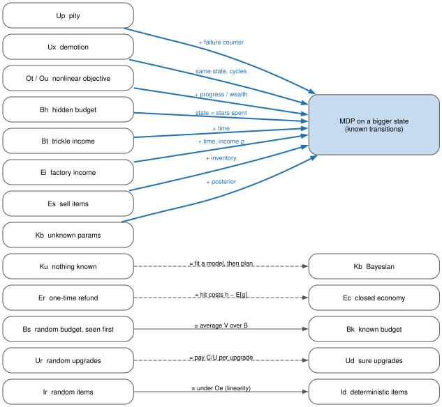
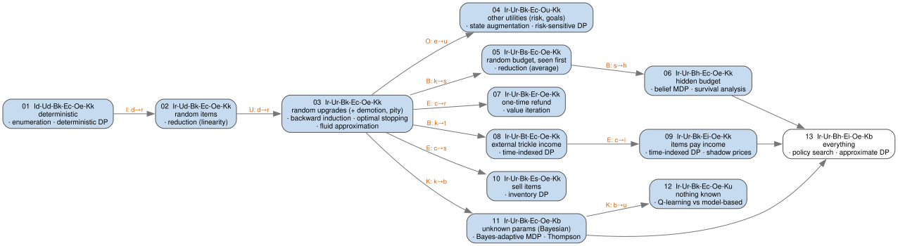

# Sequential decision-making under uncertainty

*One toy game, made harder one assumption at a time. Each step names the tool that solves
it; the tools themselves live in sub-folders with notes and code.*

## The game

A **core** produces **items** rated 1 to $M$ stars. The core has levels $1..N$. Your
currency is **coins**, and you have a budget of them. You can spend coins two ways:

- **Hit** the core: pay $h$, receive an item. A higher core level gives better odds of
  high-star items.
- **Upgrade** the core from $L$ to $L+1$: pay $C_L$, succeed with probability $U_L$.
  Upgrades usually get pricier and riskier as $L$ rises.

**Question:** with a given budget, how do you play to maximise the expected **utility**
$E[u(j_1, j_2, \dots)]$? Here $j_k$ is the star rating of the $k$-th item you get, and $u$
says how much you like the whole collection. Coins left over at the end count for nothing.
Examples of $u$:

- **total stars** $j_1 + j_2 + \dots$: the **baseline**, used until problem 04;
- "at least one 5★": $u = 1$ if any $j_k = 5$, else 0;
- a concave function of total stars, for a player who dislikes risk.

Every variant below is a version of one trade-off: **invest** (upgrade, so future hits
are better) vs. **harvest** (hit now, and get more items).

*"Sequential"* means you decide, see what happened, and decide again. In general the answer is
therefore a **policy** (a rule: in this situation, do this), not a fixed plan.

## Notation

Words: **stars** only ever describe item quality; **coins** are the currency; **utility**
$u$ is what we maximise (in expectation); **value** $V$ is the best achievable expected
utility (expected total stars, under the baseline).

| Symbol | Meaning |
|---|---|
| $N$, $L$ | number of core levels, current level |
| $M$, $j$ | number of star tiers, a tier |
| $P(L, j)$ | probability a hit at level $L$ gives a $j$★ item |
| $j_k$ | star rating of the $k$-th item obtained |
| $u(j_1, j_2, \dots)$ | utility of the collection; baseline $u = \sum_k j_k$ (total stars) |
| $r_L = \sum_j j \cdot P(L,j)$ | expected stars from one hit at level $L$ |
| $h$ | cost of a hit |
| $C_L$, $U_L$ | cost and success probability of upgrading $L \to L+1$ |
| $C_{\lt k} = \sum_{i\lt k} C_i$ | total cost of upgrading from level 1 to level $k$ |
| $\Delta$ | budget grid step: gcd of all costs |
| $B$, $F_B$, $S(x)$ | budget, its distribution, its survival function $P(B \ge x)$ |
| $b$, $s$ | coins remaining, coins spent so far |
| $g_j$, $\rho$, $T$, $t$ | coins per tick earned by a $j$★ item, total income rate, horizon, time |
| $V$, $\pi$ | value function, policy |

### Running example

The same numbers are used everywhere, so results can be compared across problems
([`common/model.py`](common/model.py)):

- $N = 7$ core levels, $M = 5$ star tiers, $h = 200$
- $C = (400, 600, 900, 1300, 1800, 2500)$
- $U = (0.70, 0.60, 0.50, 0.40, 0.30, 0.25)$
- $P(L, \cdot)$ shifts from mostly 1★ at level 1 to mostly 5★ at level 7, giving
  $r = (1.36, 1.78, 2.34, 3.00, 3.66, 4.22, 4.64)$

## Classifying the variants: six axes

Every variant gets a tag `I?-U?-B?-E?-O?-K?`. Each axis answers one question. On every axis
the first value is a special case of the others (e.g. a sure upgrade is a random one with
$U = 1$); it gets its own value because it unlocks simpler methods.

| Axis | Question | Values |
|---|---|---|
| **I** | Is the item outcome random? | `Id` no (each hit gives exactly $r_L$) · `Ir` yes |
| **U** | Is the upgrade outcome random? | `Ud` no (always succeeds) · `Ur` yes |
| **B** | What do you know about the budget, and does it grow? | `Bk` known · `Bs` random, seen before play · `Bh` hidden (you find out when you run out) · `Bt` trickle (coins arrive over time from outside) |
| **E** | Do items feed back into coins? | `Ec` no (closed) · `Er` one-time refund per item · `Ei` items pay income (every item held pays coins each tick) · `Es` items can be sold (they then no longer count toward $u$) |
| **O** | Is the utility $u$ a plain sum over items? | `Oe` yes: total stars $u = \sum_k j_k$ · `Ou` no: any other $u(j_1, j_2, \dots)$; its shape sets the behaviour (concave → avoids risk; a step at a goal, e.g. "at least one 5★" → can seek risk) |
| **K** | Do you know the probabilities? | `Kk` known · `Kb` known family, unknown parameters (Bayesian) · `Ku` unknown |

What additivity (`Oe`) buys: the state needs no memory of past items; item randomness can be
replaced by its mean $r_L$ (linearity of expectation); rewards arrive hit by hit (the
standard MDP form); and the closed forms and approximations of problems 01–03 work.
`Ou` pays with a bigger state (whatever summary of the items $u$ depends on) and loses
those shortcuts.

Two notes on the **K** axis:

- **A parametric distribution vs. a given table is not an axis.** Both are `Kk`. The
  solver only ever sees the table. The parametric form still matters for closed-form
  insights (an exponential budget is memoryless, so the policy is stationary) and for how
  fast you can learn (`Kb`).
- **Known vs. unknown is an axis.** Not knowing the odds adds a new trade-off: explore
  (spend to learn) vs. exploit.

### Mechanics: rule tweaks, not axes

These change the rules but not the kind of problem. They are solved with the same DP, with
an extra outcome or one extra state variable:

| Mechanic | Rule | What it changes |
|---|---|---|
| **demotion** | a failed upgrade drops the core a level with probability $D_L$ | 3 outcomes per attempt; coins still only go down, so the same backward induction works |
| **pity** | success chance rises with the number of failures $f$, reset on success | odds depend on history → add $f$ to the state |
| **hit cap** | at most a fixed number of hits per core level | add "hits used at this level" to the state |
| **time-varying odds** | odds change on a schedule (events) | add time $t$ to the state |

### Reductions: most tags collapse

There are $2 \cdot 2 \cdot 4 \cdot 4 \cdot 2 \cdot 3 = 384$ tags, but most reduce to
something already solved. Most of the hard variants become a standard **MDP on a bigger
state**. Learning to spot these reductions is half the skill.



## The ladder

Each problem loosens one axis of an earlier one.
Status: ✅ built · ⬜ planned.



| # | Tag | What changes | Tools | |
|---|---|---|---|---|
| [01](problems/01_Id-Ud-Bk-Ec-Oe-Kk/) | `Id-Ud-Bk-Ec-Oe-Kk` | nothing random | enumeration, deterministic DP | ✅ |
| 02 | `Ir-Ud-Bk-Ec-Oe-Kk` | item quality random | reduction (linearity of expectation) | ⬜ |
| 03 | `Ir-Ur-Bk-Ec-Oe-Kk` | upgrades can fail (+ demotion, pity mechanics) | MDP / backward induction, optimal stopping, fluid approximation | ⬜ |
| 04 | `Ir-Ur-Bk-Ec-Ou-Kk` | nonlinear objective (incl. goals) | state augmentation, risk-sensitive DP | ⬜ |
| 05 | `Ir-Ur-Bs-Ec-Oe-Kk` | budget random, seen first | reduction (average) | ⬜ |
| 06 | `Ir-Ur-Bh-Ec-Oe-Kk` | budget hidden | survival analysis, POMDP → MDP, value of information | ⬜ |
| 07 | `Ir-Ur-Bk-Er-Oe-Kk` | items refund coins (coins can go up) | value iteration | ⬜ |
| 08 | `Ir-Ur-Bt-Ec-Oe-Kk` | outside income over time | time-indexed DP | ⬜ |
| 09 | `Ir-Ur-Bk-Ei-Oe-Kk` | items pay income | time-indexed DP, optimal control (Pontryagin, turnpike) | ⬜ |
| 10 | `Ir-Ur-Bk-Es-Oe-Kk` | items can be sold | inventory state | ⬜ |
| 11 | `Ir-Ur-Bk-Ec-Oe-Kb` | odds unknown, family known | Bayesian adaptive MDP, Thompson sampling | ⬜ |
| 12 | `Ir-Ur-Bk-Ec-Oe-Ku` | nothing known | model-free RL | ⬜ |
| 13 | `Ir-Ur-Bh-Ei-Oe-Kb` | everything at once | policy search, approximate DP | ⬜ |

### 01 · Fully deterministic: `Id-Ud-Bk-Ec-Oe-Kk`

**What changed:** nothing; this is the baseline. Every hit gives exactly $r_L$, every
upgrade succeeds.

**Formulation:** state $(b, L)$; actions hit, upgrade, stop.

```math
V(b,L) = \max\{\, r_L + V(b-h, L),\; V(b-C_L, L+1),\; 0 \,\}
```

**Key structure:** if $r_L$ increases with $L$, any upgrades you make should come
*before* any hits. The only decision left is how far to upgrade.

**Tools:** [enumeration](problems/01_Id-Ud-Bk-Ec-Oe-Kk/enumeration/) (try every $k$);
[deterministic DP](problems/01_Id-Ud-Bk-Ec-Oe-Kk/deterministic_dp/) (longest path in a
DAG; needed once the structure breaks, e.g. under the hit-cap mechanic).

**On the running example:** richer means investing more. Below about 1,700 coins, don't
upgrade at all. The best target level is 3 at $B$ = 5,000, 6 at 20,000, and 7 from about
32,600 up. Value at $B$ = 20,000: **316.5**.

### 02 – 13

*Planned.*

## Results so far

Each problem reports its value (best expected total stars) on the running example:

| # | $B$ = 5,000 | $B$ = 20,000 | Note |
|---|---|---|---|
| 01 | 46.80 | 316.50 | upgrades always succeed (an upper bound for 03) |

## Fields this touches

The same core problem appears under different names:

| Field | Name for it | Emphasis |
|---|---|---|
| Operations research | stochastic DP, Markov decision processes | exact solutions, structure of optimal policies |
| Control theory | stochastic optimal control | continuous time, HJB equation, Pontryagin |
| Economics | dynamic optimisation, capital accumulation | shadow prices, turnpike theorems |
| CS / ML | reinforcement learning | huge state spaces, learning unknown dynamics |
| Applied probability | optimal stopping, survival analysis | hazard rates, random horizons |
| Game design | gacha / idle-game economy | tuning $P$, $U$, $C$ so players face interesting trade-offs |

## Repo layout & running the code

```
common/      model (Game, EXAMPLE), Monte Carlo simulator, plot style, loader
figures/     graphviz sources + svg (./figures/build.sh)
problems/NN_<tag>/            problem README
problems/NN_<tag>/<method>/   method README + solve.py + svg
```

Each `solve.py` runs on its own (`python solve.py`). Every solver is checked against the
simulator in [`common/simulate.py`](common/simulate.py). The rule of thumb: **DP finds a
policy; simulation evaluates one.** Requires numpy and matplotlib.
