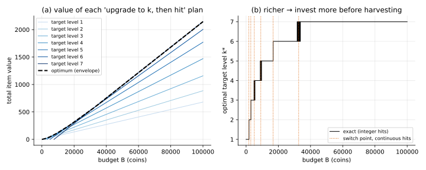

# 01 · `Id-Ud-Bk-Ec-Oe-Kk`: the fully deterministic game

| Axis | Value | Meaning here |
|---|---|---|
| I | `Id` | every hit at level $L$ yields exactly $r_L$ (no luck) |
| U | `Ud` | every upgrade succeeds |
| B | `Bk` | budget $B$ known up front |
| E | `Ec` | closed economy: items don't produce coins |
| O | `Oe` | maximise total item worth |
| K | `Kk` | all numbers known |

Nothing is random. This is the baseline every later problem is compared against.

## Formulation

- **State** $(b, L)$: coins left, core level.
- **Actions**
  - *hit*: pay $h$, gain $r_L$, stay at $L$.
  - *upgrade*: pay $C_L$, gain nothing now, move to $L+1$.
  - *stop*.
- **Objective**: maximise total gain.

```math
V(b, L) = \max\Big\{\, r_L + V(b-h,\, L),\;\; V(b - C_L,\, L+1),\;\; 0 \,\Big\}
```

(an action is only allowed if affordable). The answer is $V(B, 1)$.

## The structure that makes it easy

If $r_L$ increases with $L$, **never hit before an upgrade you're going to make anyway**:
moving that hit to after the upgrade costs the same and pays more. So every optimal plan
looks like

> **upgrade straight to some target level $k$, then spend everything else on hits.**

The whole problem collapses to choosing one number, $k$:

```math
V(B) = \max_k \; r_k \left\lfloor \frac{B - C_{<k}}{h} \right\rfloor, \qquad C_{<k} = \sum_{i<k} C_i
```

That is the **invest vs. harvest** trade-off in its purest form: a bigger $k$ means
fewer hits, each worth more.

## Tools

| Method | When | Link |
|---|---|---|
| **Enumeration** over target level | the "upgrades before hits" structure holds | [enumeration/](enumeration/) |
| **Deterministic DP** (longest path in a DAG) | always; needed once the structure breaks | [deterministic_dp/](deterministic_dp/) |

## On the running example

Upgrades always succeed here, at the listed costs $C = (400, 600, 900, 1300, 1800, 2500)$, with $h = 200$.

| Budget $B$ | 1 000 | 5 000 | 10 000 | 20 000 | 50 000 | 100 000 |
|---|---|---|---|---|---|---|
| Optimal value | 6.80 | 46.80 | 124.44 | 316.50 | 983.68 | 2143.68 |
| Target level $k^*$ | 1 | 3 | 5 | 6 | 7 | 7 |



**Takeaways**

- **Richer → invest more.** Below about 1 700 coins, don't upgrade at all. After that the
  best target level rises in steps with the budget (panel b).
- The switch points are roughly where one plan's line overtakes the next. With
  continuous hits they are exact:
  $`B^*_k = \dfrac{C_{\lt k+1}\, r_{k+1} - C_{\lt k}\, r_k}{r_{k+1} - r_k}`$ (≈ 1.7k, 2.9k, 5.1k, 9.1k, 16.8k, 32.6k).
- Near a switch point the exact answer flickers between two levels. That comes from the
  $\lfloor\cdot\rfloor$: a leftover of less than one hit can tip the choice. It's a small
  effect in value terms, but it's why integer problems rarely have clean closed forms.

## What's next

[02](../02_Ir-Ud-Bk-Ec-Oe-Kk/): make the **item quality random** ($I$: `Id → Ir`).
The optimal plan and its expected worth stay the same; only the spread of outcomes changes.
