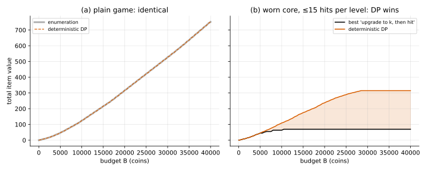

# Deterministic dynamic programming (longest path in a DAG)

## Idea

Draw every **state** as a node and every **action** as an edge labelled with its reward.
Spending coins always lowers $b$, so the graph has no cycles: it is a DAG. The best
plan is the **longest path** from the start node, and the value of a node is the best
reward-to-go:

$$
V(\text{state}) = \max\Big(0,\; \max_{\text{action}} \big[\text{reward} + V(\text{next state})\big]\Big)
$$

Compute it with memoised recursion, or bottom-up in order of increasing $b$. Then follow
the argmax from the start to read off the plan.

This is the **Bellman equation** without any expectation. Problem 03 adds the
expectation, and the same code skeleton becomes an MDP solver.

## Why bother, if enumeration works?

DP needs **no insight** into the problem. You describe the rules (which actions are
allowed, what they cost, where they lead) and it finds the optimum. Enumeration needed
the "upgrade first" argument, and that argument is fragile.

The demo breaks it on purpose with a **worn core**: each level can be hit at most
`CAP = 15` times. Now the best plan harvests at several levels. At $B = 20\,000$:

```
up->2, up->3, hit@3 x2, up->4, hit@4 x15, up->5, hit@5 x15, up->6, hit@6 x15, up->7, hit@7 x15
```

No single target level describes that plan. The state needs one more variable,
`hits used at this level`, and DP handles that by adding it to the state.



- **(a)** Plain game: DP and enumeration agree to $10^{-12}$.
- **(b)** Worn core: the best "upgrade to $k$, then hit" plan stalls at about 70, while DP
  keeps growing (315 vs 69.6 at $B = 28\,500$).

## Cost

$O(\#\text{states} \times \#\text{actions})$.

- Plain game: about $(B/g) \cdot N$ states, where $g = \gcd$ of all costs.
- Worn core: multiply by `CAP`.

Every new piece of information the plan must remember multiplies the state count. That
growth is the **curse of dimensionality**, and it comes back in the later problems.

## Equivalent views

- **Longest/shortest path** on a DAG: DP is that path computation.
- **Integer program**: maximise $\sum_L r_L x_L$ subject to the budget, where $x_L$ is
  the number of hits at level $L$. Handy when there are many side constraints and
  an IP solver is available.
- **Unbounded knapsack** with a "prerequisite" twist: an item (a hit at level $L$) is
  only available after paying for the upgrades below it.

## Code

[`solve.py`](solve.py)

- `solve(start, actions) -> (value, plan)`: the generic solver. `actions(state)` returns
  a list of `(name, reward, next_state)`.
- `plain_actions(game)`, `capped_actions(game, cap)`: the two rule sets.
- `main()`: runs both demos and writes `dp_vs_enumeration.svg`.

```
python solve.py
```

## References

- Bertsekas, *Dynamic Programming and Optimal Control*, Vol. 1, ch. 1–2 (deterministic DP, shortest paths).
- Cormen et al., *Introduction to Algorithms*, ch. 15 (DP), 24 (shortest paths in DAGs).
