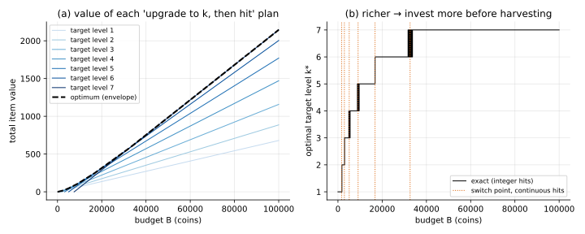

# Enumeration (brute force over a small decision)

## Idea

Sometimes a structural argument shrinks a big decision space to a tiny one. Then you
just **try every option** and keep the best.

Here the argument is "upgrade first, then hit" (see the [problem README](../README.md)).
It turns a choice among exponentially many action sequences into a choice among $N$ target
levels:

$$
V(B) = \max_{k \in 1..N} \; r_k \left\lfloor \frac{B - K_k}{h} \right\rfloor
$$

## When it applies

- The structure argument holds: deterministic, $r_L$ increasing, no per-level limits.
- **Breaks** as soon as the best plan isn't "pick one number". Two examples:
  - hits capped per level (see [deterministic_dp](../deterministic_dp/));
  - random upgrades, where the plan must react to luck (problem 03).

## Cost

$O(N)$ per budget. Trivial.

## Bonus: the continuous version

If you pretend hits can be fractional (drop the floor), plan $k$ is a straight line in
$B$ with slope $r_k/h$. The optimum is the **upper envelope** of $N$ lines. Plan $k+1$
overtakes plan $k$ at

$$
B^*_k = \frac{K_{k+1} r_{k+1} - K_k r_k}{r_{k+1} - r_k}.
$$

This "drop the integrality, get clean formulas" move is the seed of the
**fluid approximation** used in problem 03.

## Code

[`solve.py`](solve.py)

- `solve(game, B) -> (value, k)`
- `per_target(game, B)`: the value of every target level
- `switch_budgets(game)`: the continuous switch points
- `main()`: prints a table, checks one budget against the simulator, writes
  `value_vs_budget.svg`

```
python solve.py
```


