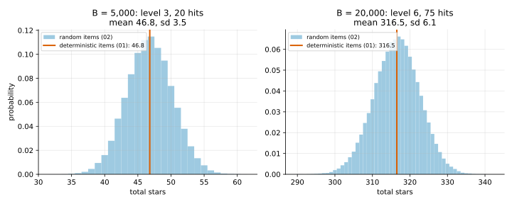

# 02 · `Ir-Ud-Bk-Ec-Oe-Kk`: random items

| Axis | Value | Meaning here |
|---|---|---|
| I | **`Ir`** | a hit at level $L$ gives a $j$★ item with probability $P(L, j)$ |
| U | `Ud` | every upgrade succeeds |
| B | `Bk` | budget $B$ known up front |
| E | `Ec` | closed economy: items don't produce coins |
| O | `Oe` | maximise expected total stars |
| K | `Kk` | all numbers known |

**What changed from [01](../01_Id-Ud-Bk-Ec-Oe-Kk/):** a hit no longer gives exactly $r_L$
stars; it gives a random item. Upgrades are still sure.

## Formulation

State $(b, L)$ as before. The hit now averages over the item it produces:

```math
V(b, L) = \max\Big\{ \sum_j P(L,j)\,\big[\, j + V(b-h,\, L) \,\big],\;\; V(b - C_L,\, L+1),\;\; 0 \Big\}
```

Since $\sum_j P(L,j) = 1$ and $\sum_j j \cdot P(L,j) = r_L$, the hit term is
$r_L + V(b-h, L)$: **exactly 01's equation**. Same values, same optimal plan.

## Why it reduces to 01

Two things make the randomness harmless here:

1. **Linearity of expectation.** The utility is a plain sum (`Oe`), so the expected stars
   from a hit are $r_L$, no matter what other items you got.
2. **The item doesn't change the state.** After a hit you are at $(b-h, L)$ whichever item
   came out. So there is nothing to react to: the best policy ignores item outcomes, and
   01's fixed plan stays optimal.

Each condition belongs to an axis, and later problems remove them:

- With a non-additive utility (`Ou`, e.g. "at least one 5★"), *which* items you got
  matters. That's problem 04.
- When items feed back into coins (`Er`, `Ei`, `Es`), the item changes $b$, so the best
  move can depend on which item came out. That's problems 07–10.

## Tool

None new: this is a **reduction** to 01. [`verify.py`](verify.py) checks it on the running
example. It plays 01's optimal plan in the random-item game with the shared simulator,
compares the mean to 01's value, and compares the spread to the exact standard deviation.

## On the running example

| Budget $B$ | 01 plan | 01 value | 02 exact mean | 02 simulated mean (n = 2000) | 02 sd: exact / simulated |
|---|---|---|---|---|---|
| 5,000 | level 3, 20 hits | 46.80 | 46.80 | 46.83 ± 0.15 | 3.48 / 3.42 |
| 20,000 | level 6, 75 hits | 316.50 | 316.50 | 316.31 ± 0.27 | 6.07 / 6.11 |



**Takeaways**

- The mean is unchanged; the simulator agrees within its 95% interval.
- What randomness adds is **spread**. With $n$ hits at level $k$, the standard deviation is
  $\sqrt{n} \cdot \sigma_k$, where $\sigma_k$ is the spread of one hit. It grows like
  $\sqrt{n}$ while the mean grows like $n$. On the running example the sd is 7.4% of the
  mean at 5,000 coins and 1.9% at 20,000.
- The baseline utility only looks at the mean, so it ignores this spread. A risk-averse or
  risk-seeking player (`Ou`) wouldn't, which is why problem 04 exists.

## What's next

[03](../03_Ir-Ur-Bk-Ec-Oe-Kk/): make **upgrades random** ($U$: `Ud → Ur`). Now an upgrade's
outcome *does* change the state (level $L$ or not), so a fixed plan is no longer enough:
you need a policy that reacts.
