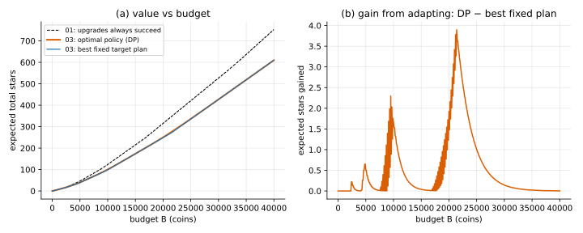
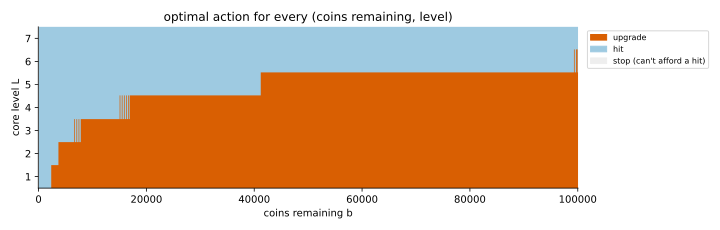
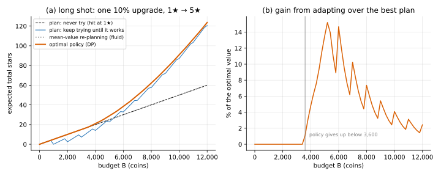

# 03 · `Ir-Ur-Bk-Ec-Oe-Kk`: random upgrades

| Axis | Value | Meaning here |
|---|---|---|
| I | `Ir` | a hit at level $L$ gives a $j$★ item with probability $P(L, j)$ |
| U | **`Ur`** | an upgrade from $L$ succeeds with probability $U_L$; you pay $C_L$ either way |
| B | `Bk` | budget $B$ known up front |
| E | `Ec` | closed economy: items don't produce coins |
| O | `Oe` | maximise expected total stars |
| K | `Kk` | all numbers known |

**What changed from [02](../02_Ir-Ud-Bk-Ec-Oe-Kk/):** upgrades can fail.

## Formulation

State $(b, L)$. The upgrade term now averages over success and failure:

```math
V(b, L) = \max\Big\{\; r_L + V(b-h,\, L),\;\; U_L\, V(b - C_L,\, L+1) + (1 - U_L)\, V(b - C_L,\, L),\;\; 0 \;\Big\}
```

Unlike the item in 02, the upgrade outcome **changes the state**: you are at level $L+1$ or
still at $L$, with less money either way. So the best next move depends on what happened,
and the answer is a **policy**, an action for every $(b, L)$, not a fixed plan.

## Why the previous tools fall short

- **Enumeration** picks one target level up front. Played for real, that plan keeps trying
  for its target however badly the upgrades go. It can't react.
- **Deterministic DP** has no expectation in it.

## Tools

| Method | What it gives | Link |
|---|---|---|
| **Backward induction** (finite MDP) | the exact optimal policy and its value | [backward_induction/](backward_induction/) |
| **Optimal stopping** | the shape of that policy: one threshold per level | [optimal_stopping/](optimal_stopping/) |
| **Fluid / mean-value approximation** | a cheap estimate: replace randomness by means, reuse 01's tools | [fluid_approximation/](fluid_approximation/) |
| Mechanics: **demotion, pity** | same backward induction, with a third outcome or a bigger state | [mechanics_variants/](mechanics_variants/) |

## On the running example

| Budget $B$ | 01/02 (sure upgrades) | 03 optimal policy | 03 best fixed plan (target) | gain from adapting |
|---|---|---|---|---|
| 5,000 | 46.80 | 40.64 | 40.14 (level 3) | 0.50 |
| 20,000 | 316.50 | 250.35 | 248.43 (level 4) | 1.92 |
| 50,000 | 983.68 | 796.36 | 792.99 (level 5) | 3.37 |

The simulator, playing the DP policy, gets 40.70 ± 0.31 at 5,000 and 250.54 ± 1.44 at
20,000 (95% intervals, 2,000 games).





**Takeaways**

- **Failing upgrades cost a lot; reacting to them recovers little.** Compared with sure
  upgrades, the optimal value drops 13% at 5,000 coins and 21% at 20,000. The best fixed
  plan is within 6.1 stars of the optimal policy at every budget up to 100,000, at most
  2.4% (at 9,500 coins).
- **The gain from adapting peaks where the best fixed plan is undecided**, i.e. near the
  budgets where its target level changes (about 2.6k, 4.8k, 9.7k, 21.4k, 51.9k).
- **The policy is a threshold rule**: upgrade from level $L$ only while coins ≥ $`b^*_L`$,
  with $`b^*_L`$ rising with $L$ (2,400 · 3,800 · 7,900 · 16,900 · 41,200 · 104,700). After a
  failed upgrade you have less money, so you may drop below the threshold and switch to
  hitting. That is the adaptivity. Details in [optimal_stopping](optimal_stopping/).
- **The cheap approximation is close on this example** (not always: see the stress example
  below). Replanning with expected costs $C_L/U_L$ (01's
  enumeration rerun at every state) loses at most 1.9% against the exact policy. Details in
  [fluid_approximation](fluid_approximation/).

## Where adapting matters: a stress example

On the running example the policy beats the best plan by at most 2.4%, because each budget
buys dozens of hits and luck averages out. Making the running example harsher (a 10–15%
bottleneck upgrade, demotion, lower odds everywhere) didn't push this past about 4%.

What does: **one gamble that decides a lot, with a budget near its expected cost.** The
second shared example, `LONG_SHOT` in `common/model.py`, is built for that and nothing else:

- level 1: every hit gives a 1★ item;
- one upgrade: costs 1,000, succeeds 10% of the time (expected cost 10,000); afterwards
  every hit gives 5★.

| budget | plan: never try | plan: keep trying until it works | optimal policy | gain over the best plan | mean-value re-planning |
|---|---|---|---|---|---|
| 4,000 | 20.00 | 14.03 | 21.00 | 4.8% | 20.00 |
| 5,000 | 25.00 | 22.62 | 28.90 | 13.5% | 25.00 |
| 7,000 | 35.00 | 44.57 | 49.66 | 10.2% | 35.00 |
| 10,000 | 50.00 | 87.17 | 90.88 | 4.1% | 50.00 |
| 20,000 | 100.00 | 280.39 | 281.69 | 0.5% | 254.30 |

- **The policy: try while coins ≥ 3,600, then give up and hit.** Neither plan can give
  up halfway; that's the whole gain, up to 15.2% (at 5,200 coins).
- **Mean-value re-planning fails badly here:** with the upgrade priced at its expected
  cost (10,000) it only tries above 12,500 coins, and loses up to 52.5% (at 12,400). The
  average hides the spread: 27% of the time the upgrade works within 3 tries (3,000 coins).
- Simulator at 5,000: 29.54 ± 0.92 vs 28.90 (4,000 games).



## What's next

[04](../04_Ir-Ur-Bk-Ec-Ou-Kk/): change **what counts as winning** ($O$: `Oe → Ou`). With a
non-additive utility (risk attitude, or a goal like "at least one 5★"), which items you got
starts to matter, and the state has to remember it.
