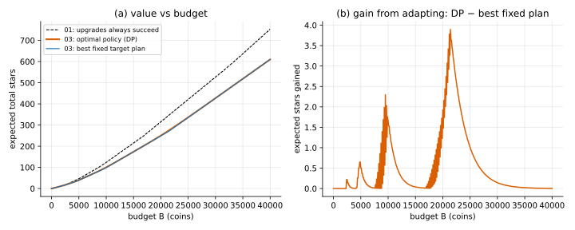
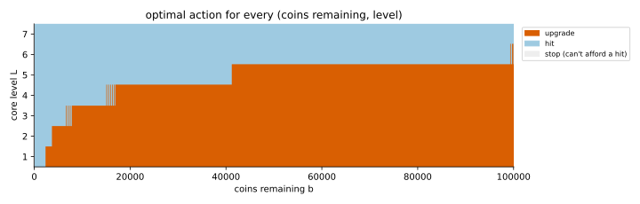

# Backward induction (finite-horizon MDP)

## Idea

A **Markov decision process** (MDP) is the deterministic DP from 01 with random outcomes:
each action leads to one of several next states, with known probabilities. The value of a
state is the best *expected* reward-to-go:

```math
V(s) = \max_{a} \Big( \text{reward}(s, a) + \sum_{s'} P(s' \mid s, a)\, V(s') \Big)
```

Here the state is $(b, L)$, and every action costs coins, so every transition goes to a
smaller $b$. Fill the table in order $b = 0, \Delta, 2\Delta, \dots$: each entry only needs
entries already computed. That order, from the end of the game backwards, is **backward
induction**.

The output is a **policy**: the best action for every state, not one fixed sequence of
actions. Play it by looking up your current $(b, L)$ after each step.

## Two uses of the same recursion

- **Optimise** (`solve`): take the max over actions. Gives the optimal value $V$ and policy $A$.
- **Evaluate** (`evaluate`): the action is dictated by a given policy instead of maximised.
  Gives that policy's exact expected value, with no simulation noise. Used here to score the
  fixed-target plans, and in the sibling folders to score approximate policies.

## When it applies

- Finite states, known transition probabilities (`Kk`).
- Some ordering in which each state only depends on "later" ones. Here that's the
  budget, which only goes down. The **demotion** mechanic keeps this: the level can drop,
  but $b$ still falls. When the full state can repeat (coins can go up, or there's no end),
  you need **value iteration** instead (problem 07).

## Cost

O(#states × #actions × #outcomes): here
$(B/\Delta) \cdot N \cdot 2 \cdot 2$, about 28k operations at $B = 100{,}000$. Each extra state
variable (pity counter, items so far, time) multiplies the state count.

## Code

[`solve.py`](solve.py)

- `solve(game, B_max) -> (V, A)`: optimal value and action for every $(b, L)$; supports demotion.
- `evaluate(game, policy, B_max)`: exact value of a given `policy(b, L)`.
- `target_policy(game, k)`, `best_fixed_target(game)`: the fixed-target baseline.
- `main()`: prints the comparison table, checks the DP policy with the simulator, writes
  `value_vs_budget.svg` and `policy_map.svg`.

```
python solve.py
```




