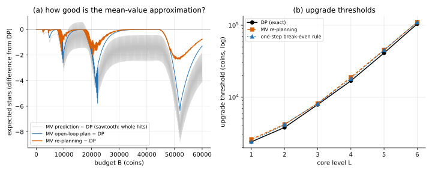

# Fluid / mean-value approximation

## Idea

Replace every random quantity by its mean, solve the deterministic problem that's left,
and use the answer as an approximation (MV below). It's called a **fluid** model when the
quantities are treated as continuous.

Naming note: control theory calls this the *certainty-equivalent* problem. This tutorial
saves "certainty equivalent" for its other meaning, the sure amount worth as much as a
gamble ([04](../../04_Ir-Ur-Bk-Ec-Ou-Kk/)). The re-planning policy below keeps its
standard name, certainty-equivalent control.

Here the only new randomness is upgrade success. An upgrade from $L$ takes a geometric
number of tries with mean $1/U_L$, so its expected cost is $C_L/U_L$. With that cost, the
problem is problem 01 again, solved by enumeration:

```math
V_{MV}(B) = \max_k \; r_k \left\lfloor \frac{B - \sum_{i \lt k} C_i / U_i}{h} \right\rfloor
```

## Three ways to use it

1. **Prediction:** $V_{MV}(B)$ as an estimate of the optimal value.
2. **Open-loop plan:** pick the MV target level once, then play "try to upgrade to it, then hit".
3. **Re-planning** (certainty-equivalent control): at every state $(b, L)$, re-solve the
   MV problem from there, and upgrade iff its best target is above $L$. This is a
   closed-loop policy built from an open-loop calculation, the idea behind model
   predictive control.

**Why re-planning is only approximate here.** Certainty-equivalent control is exactly
optimal in one classic setting: linear dynamics, quadratic cost, additive Gaussian noise
(LQG). There the noise doesn't change the best action. You solve the deterministic problem
and act on the current state. If the state is only seen through noisy measurements, you
act on its Kalman-filter estimate; that's the separation principle (more in 06). This game
is not linear-quadratic: actions are discrete, the budget is a hard limit, and an upgrade
either works or doesn't. So re-planning with means is an approximation, and here it loses
up to 1.9% against the exact policy.

There's also a **one-step break-even rule**: compare "hit at $L$ forever" with "pay the
expected cost of one upgrade, then hit at $L+1$ forever". Upgrading wins when

```math
b \gt \frac{C_L}{U_L} \cdot \frac{r_{L+1}}{r_{L+1} - r_L}
```

## On the running example

All compared with the exact DP (problem 03's backward induction), budgets up to 120,000:

| Budget | DP | MV predicts | MV open-loop | MV re-planning |
|---|---|---|---|---|
| 5,000 | 40.64 | 39.78 | 40.14 | 40.53 |
| 20,000 | 250.35 | 249.00 | 248.43 | 249.31 |
| 50,000 | 796.36 | 790.56 | 792.99 | 794.20 |

| | largest gap from DP | largest relative gap |
|---|---|---|
| MV prediction | 8.78 stars (between −8.78 and +0.56) | 3.3% |
| MV open-loop plan | 6.35 stars | 2.7% |
| MV re-planning | 3.19 stars | 1.9% |

Upgrade thresholds (coins):

| Level | 1 | 2 | 3 | 4 | 5 | 6 |
|---|---|---|---|---|---|---|
| DP (exact) | 2,400 | 3,800 | 7,900 | 16,900 | 41,200 | 104,700 |
| MV re-planning | 2,600 | 4,200 | 8,200 | 18,900 | 45,400 | 110,600 |
| one-step break-even | 2,422 | 4,179 | 8,182 | 18,023 | 45,214 | 110,476 |



**Takeaways (this example)**

- Re-planning cuts the open-loop plan's worst loss from 6.35 to 3.19 stars (2.7% → 1.9% at worst).
- Both approximate rules set their thresholds **above** the DP's, so they stop upgrading
  earlier than optimal.
- The one-step rule's thresholds are close to the full re-planning ones, at the cost of
  a single formula per level.
- The prediction's sawtooth comes from whole hits (the floor), as in 01.

## Code

[`solve.py`](solve.py)

- `mv_per_target`, `mv_value`: the MV problem from any state.
- `replan_policy(game)`: certainty-equivalent control.
- `breakeven(game)`: the one-step thresholds.
- `main()`: prints the tables above and writes `mv_vs_dp.svg`.

```
python solve.py
```
