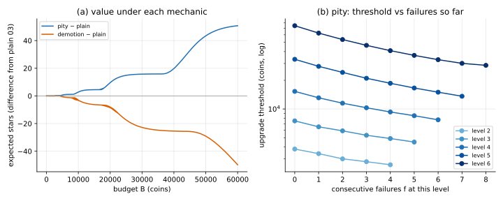

# Mechanics variants: demotion and pity

Both are rule tweaks, not new axes. Both are solved by the same
[backward induction](../backward_induction/), with either a third outcome or one extra
state variable.

## Demotion

**Rule:** a failed upgrade from $L$ also drops the core to $L-1$ with probability $D_L$.
Here $D_L = 0.3$ for every level that can drop (level 2 and up).

**Exact solution:** the upgrade term gets a third outcome,

```math
U_L\, V(b - C_L, L+1) + (1-U_L)(1-D_L)\, V(b - C_L, L) + (1-U_L)\, D_L\, V(b - C_L, L-1).
```

The level can now go down, but $b$ still falls with every action, so the same table order
works. No value iteration needed.

**Approximation:** the expected cost to climb is no longer $\sum C_L/U_L$. Climbing is a
random walk on levels (a birth–death Markov chain), and the expected cost to reach level
$k$ is an **expected hitting time**. It comes from a small linear system: with $T_k = 0$,

```math
T_L = C_L + U_L\, T_{L+1} + (1-U_L)(1-D_L)\, T_L + (1-U_L)\, D_L\, T_{L-1}.
```

| Target level | 2 | 3 | 4 | 5 | 6 | 7 |
|---|---|---|---|---|---|---|
| expected cost, no demotion ($\sum C/U$) | 571 | 1,571 | 3,371 | 6,621 | 12,621 | 22,621 |
| expected cost, with demotion (hitting time) | 571 | 1,686 | 3,820 | 8,030 | 16,978 | 35,030 |

Upgrade thresholds rise accordingly, from 2,400 · 3,800 · 7,900 · 16,900 · 41,200 · 104,700
without demotion to 2,400 · 4,200 · 9,100 · 21,300 · 60,500 · 185,900 with it.

## Pity

**Rule:** after $f$ consecutive failures at the current level, success has probability
$U_L(f) = \min(1, U_L + 0.1 f)$. It resets on success.

**Exact solution:** the odds depend on history, so $f$ joins the state, $(b, L, f)$:

```math
\text{upgrade: } U_L(f)\, V(b - C_L,\, L+1,\, 0) + \big(1 - U_L(f)\big)\, V(b - C_L,\, L,\, f+1).
```

**What the policy does:** at every level, the upgrade threshold **falls with each failure**.
Having failed more makes another attempt worth it with fewer coins in hand, because the
next attempt is more likely to succeed:

| Level | $f=0$ | $f=1$ | $f=2$ | $f=3$ | $f=4$ | … | last |
|---|---|---|---|---|---|---|---|
| 3 | 7,500 | 6,500 | 5,900 | 5,300 | 4,900 | | 4,500 ($f=5$) |
| 5 | 33,200 | 28,000 | 24,200 | 21,000 | 18,600 | | 13,600 ($f=7$) |
| 6 | 74,700 | 62,500 | 53,500 | 46,500 | 40,900 | | 28,700 ($f=8$) |

Even at $f = 0$ the thresholds are lower than without pity (level 6: 74,700 vs 104,700):
pity caps how many failures an upgrade can take, so attempts are worth starting sooner.

## On the running example

| Budget | plain 03 | demotion | pity |
|---|---|---|---|
| 5,000 | 40.64 | 39.97 | 41.28 |
| 20,000 | 250.35 | 241.74 | 259.96 |
| 100,000 | 1,842.72 | 1,751.84 | 1,927.78 |

Simulator checks at 5,000 / 20,000 coins:
- demotion: 39.92 ± 0.33 and 241.62 ± 1.40;
- pity: 41.26 ± 0.30 and 259.40 ± 1.44.



## Code

[`solve.py`](solve.py)

- `demotion_game(game)`, `hitting_cost(game, k)`: demotion setup and expected climbing cost.
- `solve_pity(game)`, `simulate_pity(...)`: the $(b, L, f)$ DP and its own simulator check.
- `main()`: prints the tables above and writes `mechanics.svg`.

```
python solve.py
```
