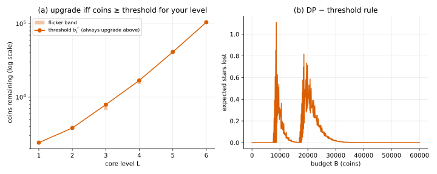

# Optimal stopping: the shape of the policy

## Idea

Many sequential problems boil down to **when to stop** doing one thing and switch to
another: sell an asset, end a search, stop investing. The optimal answer is often a
**threshold**: continue while some quantity is above a cut-off, stop once it falls below.

In this game the question is when to stop investing (upgrading) and start harvesting
(hitting). The candidate rule has one number per level:

> at level $L$: **upgrade if coins ≥ $b^*_L$**, otherwise hit.

## What the exact policy shows

Reading the backward-induction action table for the running example:

| Level $L$ | 1 | 2 | 3 | 4 | 5 | 6 |
|---|---|---|---|---|---|---|
| first budget where "upgrade" appears | 2,400 | 3,800 | 6,700 | 15,100 | 41,200 | 99,100 |
| always "upgrade" from | 2,400 | 3,800 | 7,900 | 16,900 | 41,200 | 104,700 |

- The thresholds **rise with the level**: higher levels need more money in hand before
  another upgrade is worth trying.
- At levels 3, 4 and 6 there is a **flicker band**, where hit and upgrade alternate
  as the budget grows (6, 9 and 28 grid cells of 100 coins). As in 01, whole hits cause this:
  a leftover of less than one hit can tip the choice.

How play looks: you upgrade while your coins are above the threshold for your level. A
success moves you to a higher threshold; a failure costs coins. Either can put you below
the threshold, and from then on you hit until the money runs out.

## How much does the simple rule lose?

The pure threshold rule (upgrade iff coins ≥ the "always upgrade from" value), evaluated
exactly against the DP over budgets up to 200,000:

- largest loss: 1.11 stars, at 8,700 coins (1.3%);
- at 5,000 coins: 40.64 vs 40.64; at 20,000: 250.04 vs 250.35.

So six numbers reproduce the optimal policy to within 1.3% of its value.



## Code

[`solve.py`](solve.py)

- `thresholds(game, A)`: per level, the first "upgrade" budget and the budget from which it
  always holds.
- `threshold_policy(game, b_star)`: the rule above, to evaluate with `backward_induction.evaluate`.
- `main()`: prints the threshold table and the rule's loss, and writes `thresholds.svg`.

```
python solve.py
```
