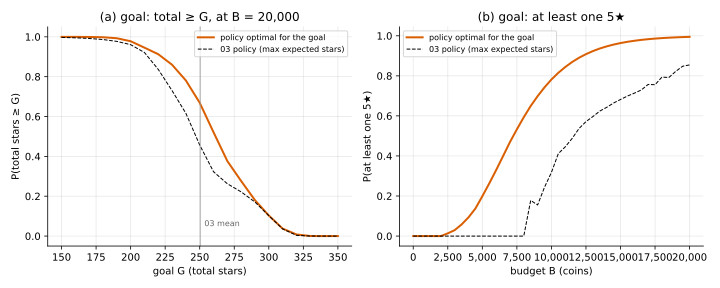

# 04 · `Ir-Ur-Bk-Ec-Ou-Kk`: other utilities

| Axis | Value | Meaning here |
|---|---|---|
| I | `Ir` | a hit at level $L$ gives a $j$★ item with probability $P(L, j)$ |
| U | `Ur` | an upgrade from $L$ succeeds with probability $U_L$; you pay $C_L$ either way |
| B | `Bk` | budget $B$ known up front |
| E | `Ec` | closed economy: items don't produce coins |
| O | **`Ou`** | maximise $E[u(j_1, j_2, \dots)]$ for a $u$ that isn't a plain sum |
| K | `Kk` | all numbers known |

**What changed from [03](../03_Ir-Ur-Bk-Ec-Oe-Kk/):** what counts as winning.

## Why the utility's shape matters

Two options with the same expected stars:

| | sure 300 stars | 50/50: 0 or 600 stars |
|---|---|---|
| expected stars | 300 | 300 |
| $u$ = total stars | 300 | 300 (indifferent) |
| $u$ = $\sqrt{\text{total}}$ (concave) | 17.3 | 12.2 (takes the sure thing) |
| $u$ = $\text{total}^2$ (convex) | 90,000 | 180,000 (takes the gamble) |

Every $u$ here is increasing, so more stars is always better for sure outcomes. Where
they differ is how they rank **gambles**. In this game every upgrade is a gamble.

Examples used below:

- **concave**: $\sqrt{W}$, where $W$ is total stars (avoids risk);
- **convex**: $W^2$ (seeks risk);
- **goals**, a step: $1[W \ge G]$, or "at least one 5★".

## Formulation

With a plain sum, each hit's stars can be paid out right away. Now $u$ is applied once,
at the end, so the state must carry whatever **summary $s$ of the items** $u$ needs:

```math
V(b, L, s) = \max\Big\{ \sum_j P(L,j)\, V(b-h, L, s \oplus j),\;\; U_L\, V(b - C_L, L+1, s) + (1 - U_L)\, V(b - C_L, L, s),\;\; u(s) \Big\}
```

where $s \oplus j$ is the summary after receiving a $j$★ item.

| $u$ | summary $s$ | size |
|---|---|---|
| any function of total stars | $W$ | up to 5 per hit: 501 values at $B$ = 20,000 |
| goal $W \ge G$ | $\min(W, G)$ | $G + 1$ |
| at least one 5★ | yes/no | 2 |

## Why the previous tools fall short

- 03's backward induction tracks only $(b, L)$: it can't tell 200 stars banked from 20.
- Linearity of expectation (02's reduction) needs a sum; $E[\sqrt{W}]$ isn't $\sqrt{E[W]}$.
- Fixed-target plans and thresholds in $b$ alone can't express "upgrade again because
  the last hits went badly".

## Tools

| Method | What it gives | Link |
|---|---|---|
| **State augmentation** | exact policy for any $u$, by adding the summary to the state | [state_augmentation/](state_augmentation/) |
| **Risk-sensitive DP** (exponential utility) | a risk dial $\theta$ that needs no extra state | [risk_sensitive/](risk_sensitive/) |

## On the running example

**Concave and convex.** Policies optimal for each $u$, played from $B$ = 20,000:

| optimal for | E[stars] | sd | mean final level |
|---|---|---|---|
| total stars (03) | 250.35 | 32.8 | 4.31 |
| $\sqrt{W}$ | 250.28 | 31.1 | 4.23 |
| $W^2$ | 250.13 | 37.0 | 4.52 |

The direction is as expected: concave upgrades a bit less and narrows the spread; convex
upgrades more and widens it. The size is small: over this outcome range (mostly 200 to
320 stars) $\sqrt{W}$ and $W^2$ are close to straight lines. The exponential family in
[risk_sensitive](risk_sensitive/) turns the curvature up: at $\theta = 0.1$ the policy
stops at level 3 (215.6 stars, sd 11.1).

**Goals**, where the difference is large:

- $W \ge 250$ (the 03 policy's mean) at $B$ = 20,000: 0.669 vs 0.457 for the 03 policy.
- $W \ge 200$ (below the mean): plays safe. Mean final level 3.27 vs 4.31, sd 15.5.
- $W \ge 300$ (above the mean): plays riskier. sd 42.1, but the gain is tiny
  (0.1033 vs 0.1026).
- At least one 5★: 0.199 vs 0.000 at 5,000 coins and 0.782 vs 0.318 at 10,000. It pays
  for that in stars: expected 17.9 vs 40.6 at 5,000.



**Takeaways**

- **The state grows by whatever $u$ looks at.** Total stars, a flag, a capped counter.
- **With $\sqrt{W}$ and $W^2$ the policy barely depends on stars banked**: only 5 and 8 of
  the 1,407 $(b, L)$ cells change with $W$. Goal policies do use it: they sometimes go back
  to upgrading after a run of hits (0.04 to 0.06 such attempts per game at $G$ = 200, 250).
- **Exponential utility needs no extra state.** Among functions of total stars, only linear
  and exponential ones make the best action independent of stars banked (they are the
  ones with constant risk aversion). [risk_sensitive](risk_sensitive/) uses this.

## What's next

[05](../05_Ir-Ur-Bs-Ec-Oe-Kk/): back to total stars, but the budget is random ($B$: `Bk → Bs`).
