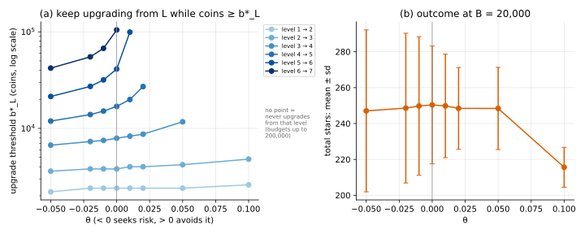

# Risk-sensitive DP (exponential utility)

## Idea

[State augmentation](../state_augmentation/) handles any $u$, at the price of a bigger state.
One family of utilities avoids that price:

```math
u_\theta(W) = \frac{1 - e^{-\theta W}}{\theta}
```

- $\theta \gt 0$: concave, avoids risk;
- $\theta \lt 0$: convex, seeks risk;
- $\theta \to 0$: $u_\theta(W) \to W$, i.e. problem 03.

Write total stars as banked plus still to come, $W = W_{\text{past}} + W_{\text{future}}$. Then

```math
e^{-\theta W} = e^{-\theta W_{\text{past}}} \cdot e^{-\theta W_{\text{future}}}
```

The banked part is a fixed positive factor, so it can't change which action is best. The
state stays $(b, L)$. Let $G(b, L)$ be $E[e^{-\theta W_{\text{future}}}]$ under the best
policy, and $m_L = \sum_j P(L,j) e^{-\theta j}$ the factor for one hit at level $L$:

```math
G(b, L) = \operatorname{opt}\Big\{ m_L\, G(b-h, L),\;\; U_L\, G(b - C_L, L+1) + (1 - U_L)\, G(b - C_L, L),\;\; 1 \Big\}
```

with opt = min for $\theta \gt 0$ and max for $\theta \lt 0$. The sum in 03's recursion
became a product.

To read the result in stars, use the **certainty equivalent**: the sure number of stars
you'd value the same as the gamble, $\text{CE} = -\ln(G) / \theta$.

## When it applies

- You're free to choose the risk attitude, and constant risk aversion is acceptable:
  a gamble of ±10 stars feels the same with 20 stars banked as with 200.
- If $u$ must be something else (a goal, $\sqrt{W}$), use state augmentation.

## On the running example

Checked against the general method: at $\theta$ = 0.02, both give E[u] = 27.579951
($B$ = 5,000) and 49.602667 ($B$ = 20,000).

| $\theta$ | thresholds, levels 1 to 6 (coins) | E[stars] at 20k | sd | final level | CE | CE of 03 policy |
|---|---|---|---|---|---|---|
| −0.05 | 2,200 · 3,600 · 6,700 · 11,900 · 21,400 · 42,100 | 247.04 | 45.1 | 4.88 | 277.52 | 275.18 |
| −0.02 | 2,400 · 3,800 · 7,300 · 13,900 · 27,200 · 55,100 | 248.59 | 41.7 | 4.76 | 263.60 | 261.13 |
| −0.01 | 2,400 · 3,800 · 7,500 · 15,100 · 31,800 · 67,500 | 249.77 | 38.6 | 4.61 | 256.98 | 255.76 |
| 0 (03) | 2,400 · 3,800 · 7,900 · 16,900 · 41,200 · 104,700 | 250.35 | 32.8 | 4.31 | 250.35 | 250.35 |
| 0.01 | 2,400 · 4,000 · 8,300 · 19,900 · 99,400 · — | 249.82 | 28.8 | 4.14 | 245.66 | 245.00 |
| 0.02 | 2,400 · 4,000 · 8,700 · 27,100 · — · — | 248.43 | 22.8 | 4.00 | 241.75 | 239.58 |
| 0.05 | 2,400 · 4,200 · 11,700 · — · — · — | 248.40 | 22.9 | 4.00 | 220.63 | 217.39 |
| 0.1 | 2,600 · 4,800 · — · — · — · — | 215.61 | 11.1 | 3.00 | 205.58 | 164.40 |

"—" = never upgrades from that level, at any budget up to 200,000.



**Takeaways (this example)**

- **One dial moves the thresholds**, the higher levels most. Seeking risk lowers them
  (upgrade sooner); avoiding risk raises them, and for $\theta \ge 0.01$ the top upgrades are never tried at any
  budget up to 200,000.
- **The mean barely moves until the attitude is strong.** From $\theta$ = −0.02 to 0.05
  expected stars stay within 2 of 250.35 while the sd ranges from 22.8 to 41.7.
- **Using 03's policy costs little for mild attitudes** (CE within 3.3 stars for
  $|\theta| \le 0.05$) and a lot for strong ones (164.4 vs 205.6 at $\theta$ = 0.1).

## Code

[`solve.py`](solve.py)

- `solve(game, theta, B_max, policy=None) -> (G, A)`: the product recursion; with
  `policy` it evaluates that policy instead.
- `ce(G, theta)`: certainty equivalent in stars.
- `main()`: the cross-check, the table above, `theta_dial.svg`.

```
python solve.py
```
