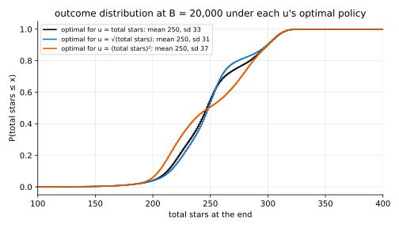
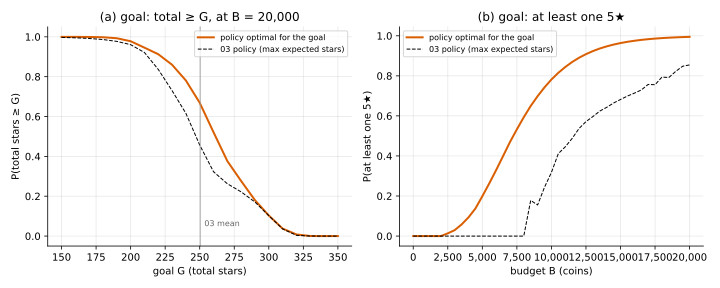

# State augmentation

## Idea

Backward induction needs a **Markov** state: the best action from here, and the value of
what's left, must depend only on the state. With total stars as the utility, $(b, L)$ is
enough: past stars are already banked and just add on.

With any other $u$, past items matter: with $u = \sqrt{W}$, 10 more stars are worth more when
you have 20 than when you have 200. Fix: **add to the state whatever $u$ reads**, and
pay $u$ once, when the game ends:

```math
V(b, L, s) = \max\Big\{ \sum_j P(L,j)\, V(b-h, L, s \oplus j),\;\; U_L\, V(b - C_L, L+1, s) + (1 - U_L)\, V(b - C_L, L, s),\;\; u(s) \Big\}
```

Same table order as [03](../../03_Ir-Ur-Bk-Ec-Oe-Kk/backward_induction/): $b$ only goes
down. The answer is a policy over $(b, L, s)$.

## Pick the smallest summary

The summary only has to be enough to compute $u$ at the end:

| $u$ | summary $s$ | update $s \oplus j$ | states |
|---|---|---|---|
| $f(W)$, any $f$ | total stars $W$ | $W + j$ | $5B/h + 1$ |
| $1[W \ge G]$ | $\min(W, G)$ | $\min(W + j, G)$ | $G + 1$ |
| at least one 5★ | flag | flag or $j = 5$ | 2 |

Capping at the goal works because once you're there, extra stars don't change $u$.

## When it applies

- Any $u$ whose input can be summarised by a small state updated item by item.
- **Cost:** the table is $|s|$ times larger than 03's. Total stars at $B$ = 20,000
  gives 201 · 7 · 501 ≈ 700k states (a few seconds in numpy). It grows with $B^2$, so for big
  budgets or richer summaries (counts of every star tier) the table becomes the problem.

## Reading off the result

Two exact tools, both in `solve.py`:

- **Forward pass** (`final_distribution`): push probability mass from the start through
  the policy to get the exact distribution of the outcome (total stars, final level).
  Used for the spread and goal numbers below, without simulation noise.
- **Simulator** (`common/simulate.py`): `Obs` now carries stars so far $W$ and the best
  item so far; `utility(items)` scores a game. Every DP value is checked against it.

## On the running example



At $B$ = 20,000 the three policies give nearly the same mean (250.1 to 250.4) but different
spreads: sd 31.1 ($\sqrt{W}$), 32.8 (total stars), 37.0 ($W^2$).



- (a) Goal $W \ge G$: the goal policy gains most near the 03 mean (250: 0.669 vs 0.457)
  and little far from it.
- (b) At least one 5★: the goal policy upgrades to level 4 or 5 and hits there. The 03
  policy never reaches level 4 below 7,700 coins, so its chance there is 0.

## Code

[`solve.py`](solve.py)

- `Utility`: a summary space, its update table and $u$ on it. Constructors
  `total_stars_utility(game, f)`, `goal_utility(game, G)`, `any_top_utility(game)`.
- `solve(game, ut, B_max) -> (V, A)`: the augmented backward induction.
- `final_distribution`, `stats`: exact outcome distribution of a policy.
- `table_policy(A, unit, ut)`: plays the policy in the simulator.
- `main()`: prints all numbers on this page, checks against the simulator, writes the svgs.

```
python solve.py
```
