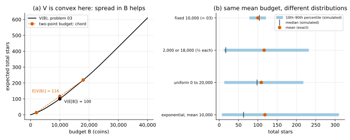

# 05 · `Ir-Ur-Bs-Ec-Oe-Kk`: random budget, seen first

| Axis | Value | Meaning here |
|---|---|---|
| I | `Ir` | a hit at level $L$ gives a $j$★ item with probability $P(L, j)$ |
| U | `Ur` | an upgrade from $L$ succeeds with probability $U_L$; you pay $C_L$ either way |
| B | **`Bs`** | the budget is drawn from a known distribution $p(B)$, and you see it before playing |
| E | `Ec` | closed economy: items don't produce coins |
| O | `Oe` | maximise expected total stars |
| K | `Kk` | all numbers known |

**What changed from [03](../03_Ir-Ur-Bk-Ec-Oe-Kk/):** the budget is random, but revealed
before the first move.

## Formulation and reduction

Once you've seen $B$, you're in problem 03 with budget $B$. So play 03's optimal policy, and

```math
\text{value} = E\big[V(B)\big] = \sum_B p(B)\, V(B)
```

No new solver. 03's backward-induction table already holds $V(b, L)$ for every $b$, and its
policy only looks at the current $(b, L)$, so **one table plays every budget**.

The question this page answers is what the randomness *does*.

## Jensen again: $E[V(B)]$ vs $V(E[B])$

Same mean budget, 10,000 coins, four distributions (exact; simulator check in the last column):

| budget | $E[V(B)]$ | sd of total stars | from which $B$ | from luck | simulator |
|---|---|---|---|---|---|
| fixed 10,000 (= 03) | 100.25 | 16.4 | 0 | 16.4 | 100.74 ± 0.51 |
| 2,000 or 18,000 (½ each) | 116.25 | 104.5 | 102.7 | 19.4 | 114.10 ± 3.23 |
| uniform 0 to 20,000 | 108.96 | 77.4 | 75.3 | 17.6 | 109.71 ± 2.41 |
| exponential, mean 10,000 | 118.35 | 156.0 | 154.3 | 23.4 | 117.99 ± 4.65 |

(Simulator: 4,000 games each, 95% intervals.)

- **A random budget beats a fixed one with the same mean**, here by 9% to 18%. That's
  Jensen's inequality with $V$ **convex**: $E[V(B)] \ge V(E[B])$.
- **Why convex:** stars per coin rise with the budget: 8.1 per 1,000 coins at 5,000,
  12.5 at 20,000, 18.4 at 100,000. A richer player spreads the upgrade costs over more
  hits at a better level. So a coin is worth more to a rich player, and a 50/50 split of
  the budget gains more on the high side than it loses on the low side.
- **Exact convexity is broken at small scales** by whole hits (01's staircase): steps of
  100 or 500 coins show local dips. Sampled every 1,000 coins, $V$ is convex all the way
  to 150,000.
- **Most of the spread comes from the budget, not the play**: total variance = variance of
  $V(B)$ + average variance given $B$ (law of total variance). Luck during play adds
  16 to 23 stars of sd; the budget adds 75 to 154.



The skew shows in (b): the exponential budget has the highest mean, but its median is
63 stars (simulated). Most players get little, a few get a lot.

## What doesn't carry over

The reduction needs two things:

- **You see $B$ before the first move.** If you don't (problem 06), you can't pick the row
  of the table, and the policy has to work for every budget at once.
- **$u$ is linear in total stars.** With a concave $u$ (04), the convexity of $V$ and the
  concavity of $u$ pull in opposite directions; average $E[u]$ over $B$ instead, using 04's
  solver per budget.

## Code

[`verify.py`](verify.py)

- `budget_distributions(du)`: the four pmfs on the budget grid.
- `second_moment(game, A, V)`: exact $E[W^2]$ for every $(b, L)$ under a policy table (the
  same backward recursion, for squares), used for the sd split.
- `main()`: the table above, the Jensen checks, the simulator runs, `budget_spread.svg`.

```
python verify.py
```

## What's next

[06](../06_Ir-Ur-Bh-Ec-Oe-Kk/): the budget is **hidden** ($B$: `Bs → Bh`). You learn it only
when you run out.
