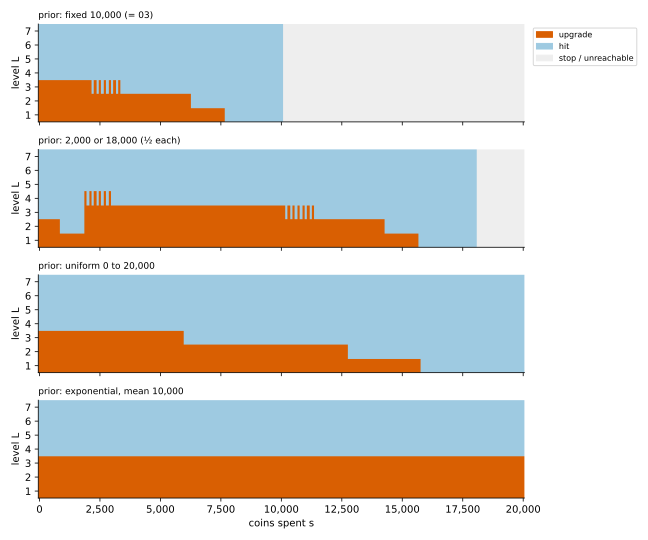

# 06 · `Ir-Ur-Bh-Ec-Oe-Kk`: hidden budget

| Axis | Value | Meaning here |
|---|---|---|
| I | `Ir` | a hit at level $L$ gives a $j$★ item with probability $P(L, j)$ |
| U | `Ur` | an upgrade from $L$ succeeds with probability $U_L$; you pay $C_L$ either way |
| B | **`Bh`** | the budget is drawn from a known distribution $p(B)$ and never shown |
| E | `Ec` | closed economy: items don't produce coins |
| O | `Oe` | maximise expected total stars |
| K | `Kk` | all numbers known |

**What changed from [05](../05_Ir-Ur-Bs-Ec-Oe-Kk/):** you don't see $B$. You see what you've
spent, $s$, and your level. If you try an action that costs more than what's left, it's
refused and the game ends; the leftover coins are lost.

## What you know at each step

The only news you ever get about $B$ is "not broke yet": $B \ge s$. So your belief about
the budget is the prior with everything below $s$ cut off:

```math
P(B = x \mid B \ge s) = \frac{p(x)}{S(s)}, \qquad S(x) = P(B \ge x)
```

$S$ is the **survival function** of the budget. The belief depends on $s$ only, so
"hidden state + belief" (a POMDP) shrinks to an ordinary MDP on $(s, L)$.

## Formulation

An action costing $c$ goes through with probability $S(s+c)/S(s)$; otherwise the game ends
with nothing more:

```math
V(s, L) = \max\Big\{ \tfrac{S(s+h)}{S(s)} \big( r_L + V(s+h, L) \big),\;\; \tfrac{S(s+C_L)}{S(s)} \big( U_L\, V(s+C_L, L+1) + (1-U_L)\, V(s+C_L, L) \big),\;\; 0 \Big\}
```

Same shape as 03, with $b$ replaced by $s$ (which only goes up) and every action
discounted by its chance of going through.

## Why the previous tools fall short

- 03's table is indexed by coins **left**, which you don't know.
- 05's reduction picks the row of 03's table for your $B$. With $B$ hidden there's no row to
  pick: one policy has to work for every budget the prior allows.

## Tools

| Method | What it gives | Link |
|---|---|---|
| **Belief MDP** | exact policy on $(s, L)$; the Kalman-filter parallel | [belief_mdp/](belief_mdp/) |
| **Survival analysis** | hazard and mean residual budget $m(s)$; the "plug in $m(s)$" heuristic | [survival_analysis/](survival_analysis/) |
| **Value of information** | what seeing $B$ is worth: 05's value − 06's value | below |

## On the running example

Same four priors as 05, all with mean 10,000:

| prior | seen (05) | hidden, optimal | value of seeing $B$ | plug in $m(s)$ | plug in $E[B] - s$ |
|---|---|---|---|---|---|
| fixed 10,000 | 100.25 | 100.25 | 0 | 100.25 | 100.25 |
| 2,000 or 18,000 (½ each) | 116.25 | 111.87 | 4.4 | 109.42 | 104.87 |
| uniform 0 to 20,000 | 108.96 | 104.00 | 5.0 | 103.98 | 102.82 |
| exponential, mean 10,000 | 118.35 | 107.76 | 10.6 | 107.76 | 104.98 |

The last two columns are heuristics (exact values, details in
[survival_analysis](survival_analysis/)): play 03's policy as if the coins left were the
mean residual budget $m(s) = E[B - s \mid B \ge s]$, or as if they were $E[B] - s$ (never
updating).

- **Not seeing $B$ costs 4% to 9% here** (4.4 to 10.6 stars). It's still better than a
  fixed budget of 10,000 for all three random priors.
- **The prior's shape sets the policy's shape:**
  - exponential: the same action at every $s$ (until the cut at 150,000 shows): upgrade to
    level 4, then hit;
  - uniform: upgrade only early: from level 1, 2, 3 while $s$ is below 15,700, 12,700,
    5,900; never from level 4;
  - 2,000 or 18,000: before 1,900 is spent, upgrade only from levels 1 and 2. Getting
    past 2,000 reveals $B$ = 18,000, and from then on it's 03's policy with 18,000 − $s$
    coins left.
- **Plugging in $m(s)$ is exact or nearly exact for the exponential and uniform priors,
  and loses 2.5 stars on the two-point prior**, where the mean (10,000) is a budget that
  never happens. Before 2,000 is spent it also upgrades from level 3, as if 8,000 or more
  coins were left; half the time only a few hundred are. Not updating at all ($E[B] - s$) loses more everywhere.



**Takeaways**

- **Hidden state → belief state.** When what you know is summarised by a few numbers that
  update as you play, the belief is the state. Here it's one number, $s$.
- **The survival function does the work**: the chance an action goes through,
  $S(s+c)/S(s)$, replaces "can I afford it?".
- **A memoryless budget gives a policy that ignores time.** With the exponential prior the
  hazard is constant and $m(s)$ is always 10,000, so the policy depends on $L$ only.

## What's next

[07](../07_Ir-Ur-Bk-Er-Oe-Kk/): back to a known budget, but items refund coins, so coins can
go up ($E$: `Ec → Er`).
