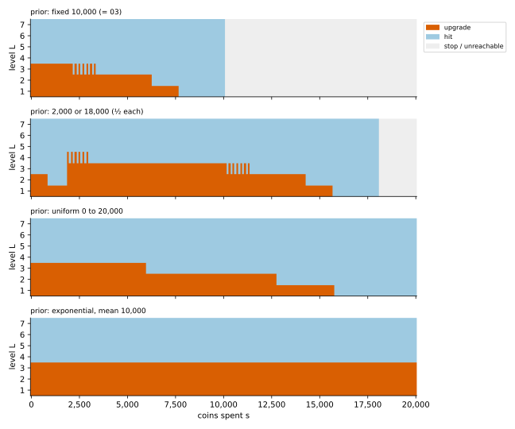

# Belief MDP

## Idea

When part of the state is hidden, act on your **belief**: the probability distribution of
the hidden part given everything you've seen. The belief is a state you *do* know, so a
problem with hidden state (a POMDP) becomes an MDP over beliefs. Usually that MDP is
hopeless: a belief is a whole distribution. Here it's easy, because the only news about
$B$ is "not broke yet":

```math
P(B = x \mid B \ge s) = \frac{p(x)}{S(s)}, \qquad S(x) = P(B \ge x)
```

The belief is fixed by $s$, so the MDP is on $(s, L)$, the same size as 03's table:

```math
V(s, L) = \max\Big\{ \tfrac{S(s+h)}{S(s)} \big( r_L + V(s+h, L) \big),\;\; \tfrac{S(s+C_L)}{S(s)} \big( U_L\, V(s+C_L, L+1) + (1-U_L)\, V(s+C_L, L) \big),\;\; 0 \Big\}
```

$s$ only goes up, so fill the table from the largest $s$ down.

## Same family as the Kalman filter

Both are **Bayes filters**: keep a belief about a hidden quantity, update it with each
observation, act on it.

| | Kalman filter | here |
|---|---|---|
| hidden quantity | a state that moves (position, velocity) | the budget $B$ (fixed) |
| observation | noisy measurement of the state | "the last action went through" |
| belief | Gaussian: mean and covariance | the prior cut off below $s$ |
| what the belief carries | mean, covariance | one number, $s$ |
| belief stays in its family because | dynamics linear, noise Gaussian | the observation only ever says $B \ge s$ |

In both, the belief is summed up by a few numbers, so the belief problem stays small.

The difference is in how you act. With linear dynamics and quadratic cost (LQG), the
**separation principle** says: estimate with the Kalman filter, then act as if the
estimate were the truth, and that is exactly optimal (see 03's
[mean-value approximation](../../03_Ir-Ur-Bk-Ec-Oe-Kk/fluid_approximation/#three-ways-to-use-it)
for why that fails there). Here the same move is "play 03's
policy as if $m(s) = E[B - s \mid B \ge s]$ coins were left". It is not exactly optimal:
it matches the optimum on the exponential and uniform priors and loses 2.5 stars on the
two-point one (see [survival_analysis](../survival_analysis/)).

One more difference: learning isn't a separate choice. The belief changes only by spending,
and you learn $B$ exactly only when an action is refused, when it's too late to use it.

## When it applies

- The belief has a small summary that updates as you play (here $s$; for linear-Gaussian
  problems the mean and covariance; for counts of successes, a few counters).
- Otherwise the belief space is too big for a table, and you need approximations
  (problem 13).

## On the running example

Optimal value at $s = 0$, checked with the simulator (`hidden_budget=True`, the policy
gets $b$ = None), 4,000 games each:

| prior (mean 10,000) | belief MDP | simulator |
|---|---|---|
| fixed 10,000 | 100.25 | 100.74 ± 0.51 |
| 2,000 or 18,000 | 111.87 | 112.12 ± 3.22 |
| uniform 0 to 20,000 | 104.00 | 102.96 ± 2.50 |
| exponential | 107.76 | 107.72 ± 4.55 |

With the fixed prior the belief is a single budget, so it's 03 exactly.



- **Fixed**: 03's policy with 10,000 − $s$ coins left (the thresholds show up mirrored).
- **Exponential**: the same action at every $s$: upgrade to level 4, then hit. Checked to
  $s$ = 129,900; past that the cut of the prior at 150,000 shows.
- **Uniform**: upgrade from level 1, 2, 3 only while $s$ is below 15,700, 12,700, 5,900.
- **2,000 or 18,000**: before 1,900 spent, upgrade only from levels 1 and 2 (from level 2
  only before 900). After 2,000 it matches 03's policy with 18,000 − $s$ coins left.

## Code

[`solve.py`](solve.py)

- `survival(pmf, pad)`: $S(x)$ on the grid.
- `solve(game, pmf, policy=None) -> (V, A)`: the backward recursion in $s$; with `policy`
  (an $(s, L)$ action table) it evaluates that policy instead.
- `hidden_policy(A, unit)`: plays the table in the simulator.
- `upgrade_region(A, L, unit)`: where the policy upgrades from level $L$.
- `main()`: the table above, the simulator check, `policy_maps.svg`.

```
python solve.py
```
