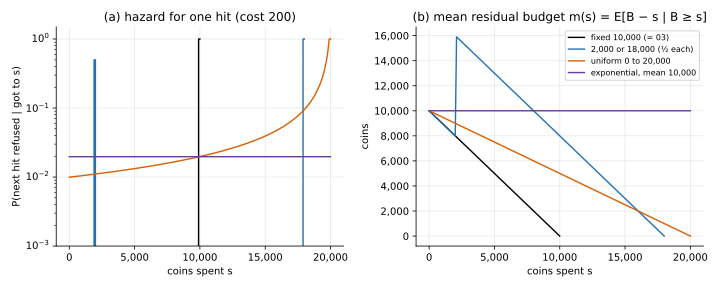

# Survival analysis

## Idea

Treat the hidden budget as a **lifetime** measured in coins: how long until you "die"
(run out). Survival analysis has names for the two summaries that matter here:

**Hazard**: the chance an action costing $c$ is refused, given you got to $s$:

```math
\lambda_c(s) = P(B \lt s + c \mid B \ge s) = 1 - \frac{S(s+c)}{S(s)}
```

**Mean residual budget** (mean residual life): coins you expect to have left,

```math
m(s) = E[B - s \mid B \ge s]
```

The [belief MDP](../belief_mdp/) multiplies every action by its chance of going through,
$1 - \lambda_c(s)$. $m(s)$
gives a cheap heuristic: **play 03's policy as if $m(s)$ coins were left.** It needs only
03's table and $m(s)$, no new DP.



| prior | hazard as you spend | $m(s)$ as you spend |
|---|---|---|
| fixed 10,000 | 0, then 1 at the end | falls one-for-one |
| 2,000 or 18,000 | 0, a jump to ½ near 2,000, 0, then 1 at the end | falls, jumps to about 16,000 after 2,000, falls |
| uniform 0 to 20,000 | rises | falls half as fast as you spend |
| exponential | constant | constant at 10,000 |

An exponential budget is **memoryless**: having spent $s$ tells you nothing about what's
left. Then the belief MDP's chances $S(s+c)/S(s)$ don't depend on $s$, and the optimal
policy doesn't either (checked in [belief_mdp](../belief_mdp/)).

## When it applies

- Any hidden "time until the end": a budget, a session length, a machine's life.
- The heuristic: here it matched the optimum when the belief had one peak or none
  (exponential, uniform) and lost when it had two separated peaks, where the mean is a
  budget that never happens (below).

## On the running example

Exact values from policy evaluation on $(s, L)$, all priors with mean 10,000:

| prior | optimal | plug in $m(s)$ | plug in $E[B] - s$ (never update) |
|---|---|---|---|
| fixed 10,000 | 100.25 | 100.25 | 100.25 |
| 2,000 or 18,000 | 111.87 | 109.42 | 104.87 |
| uniform 0 to 20,000 | 104.00 | 103.98 | 102.82 |
| exponential | 107.76 | 107.76 | 104.98 |

- **Plugging in $m(s)$ is enough for the exponential and uniform priors**: same value to 0.02 stars.
- **It loses 2.5 stars on the two-point prior.** Before 2,000 is spent, $m(s)$ is 8,000 or
  more, so it upgrades from level 3; the optimal policy doesn't, because half the time
  only a few hundred coins are left.
- **Updating matters**: $E[B] - s$ ignores that you're still playing. With the
  exponential prior it thinks the budget is nearly gone at $s$ = 9,000, while $m(s)$ is
  still 10,000. On the three random priors it loses 1.2 to 7.0 stars.

## Code

[`solve.py`](solve.py)

- `hazard(S, c)`, `mean_residual(pmf)`: the two summaries on the grid.
- `plug_in_policy(A03, b_hat)`: an $(s, L)$ table that plays 03's action at budget
  $\hat b(s)$ ("stop" becomes "hit": leftover coins are worth nothing).
- `main()`: the table above (evaluated with `belief_mdp.solve(..., policy=...)`) and
  `hazard_residual.svg`.

```
python solve.py
```
