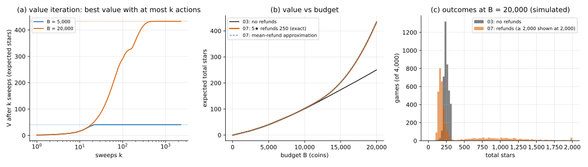

# 07 · `Ir-Ur-Bk-Er-Oe-Kk`: items refund coins

| Axis | Value | Meaning here |
|---|---|---|
| I | `Ir` | a hit at level $L$ gives a $j$★ item with probability $P(L, j)$ |
| U | `Ur` | an upgrade from $L$ succeeds with probability $U_L$; you pay $C_L$ either way |
| B | `Bk` | budget $B$ known up front |
| E | **`Er`** | each $j$★ item refunds $g_j$ coins once, when it drops |
| O | `Oe` | maximise expected total stars |
| K | `Kk` | all numbers known |

**What changed from [03](../03_Ir-Ur-Bk-Ec-Oe-Kk/):** items give coins back. On the
running example only a 5★ item refunds, **250 coins, more than a hit costs (200)**. So a
lucky hit leaves you with more coins than before.

## Formulation

```math
V(b, L) = \max\Big\{ r_L + \sum_j P(L,j)\, V(b - h + g_j,\, L),\;\; U_L\, V(b - C_L,\, L+1) + (1 - U_L)\, V(b - C_L,\, L),\;\; 0 \Big\}
```

Same as 03 except the hit term: the coins after a hit depend on the item.

A hit at level $L$ costs $h - E[g]$ on average, with $E[g] = \sum_j P(L,j) g_j$:

| level | 1–3 | 4 | 5 | 6 | 7 |
|---|---|---|---|---|---|
| mean refund per hit | 0 | 5 | 32.5 | 92.5 | 167.5 |
| net cost of a hit | 200 | 195 | 167.5 | 107.5 | 32.5 |

At level 7 a hit costs 32.5 coins on average: six times as many hits per coin as in 03.

## Why the previous tools fall short

- **03's backward induction** fills the table from small $b$ up, because every action
  lowered $b$. Now a hit can raise it (−200 + 250 = +50), and $(b, L)$ can come back to
  itself: four 5★ hits (+50 each) and one other hit (−200). There's no order that
  computes each entry once.
- **01–03's plans and thresholds** assume coins only go down.

## Tools

| Method | What it gives | Link |
|---|---|---|
| **Value iteration** | exact $V$ and policy, by repeating the Bellman update until it stops changing | [value_iteration/](value_iteration/) |
| **Mean-refund approximation** | 03's backward induction with hit cost $h - E[g]$ per level (the reduction map's `Er ≈ Ec`) | [value_iteration/](value_iteration/) |

## On the running example

| budget | 03 (no refunds) | 07 exact | mean-refund approximation |
|---|---|---|---|
| 5,000 | 40.64 | 40.64 | 40.64 |
| 10,000 | 100.25 | 102.01 | 101.58 |
| 20,000 | 250.35 | 433.16 | 436.77 |

- **At 5,000 nothing changes**: the policy doesn't reach level 4, where refunds start.
- **At 20,000 the value rises 73%**, and the policy changes shape. Thresholds (upgrade from
  level $L$ when coins ≥ this):

  | level | 1 | 2 | 3 | 4 | 5 | 6 |
  |---|---|---|---|---|---|---|
  | 03 | 2,400 | 3,800 | 7,900 | 16,900 | 41,200 | 104,700 |
  | 07 | 2,400 | 3,800 | 7,250 | 9,450 | 8,700 | 6,450 |

  They no longer rise with the level: once at level 4 with about 9,500 coins, the policy
  goes for level 7. (Levels 3 and 4 also upgrade at some scattered budgets just below
  their thresholds.)
- **The mean hides a lottery.** At 20,000 coins (simulated, 4,000 games): median 195
  stars, below 03's 247; 10th to 90th percentile 141 to 1,177; sd 460 (03: 32.8). 29% of
  games end above 400 stars (median of those: 1,010). 58% end below 213, which is 03's
  10th percentile. Here a risk attitude (04) would matter a lot; this page doesn't solve
  that combination.
- **The mean-refund approximation is within 0.8%** at these budgets (0.4 under at 10,000,
  3.6 over at 20,000).



**Takeaways**

- **When coins can go up, the state can repeat**, and you iterate instead of filling the
  table once. Value iteration from $V = 0$: after $k$ sweeps, $V$ is the best value of the
  game cut off after $k$ actions.
- **The refund only needs to be finite on average**: the game ends because every level's
  net hit cost is positive. A 5★ refund of 300 would make level 7's mean refund 201, more
  than a hit costs, and the expected stars would be unbounded.
- **Average refunds give the mean; the spread needs the exact model.**

## What's next

[08](../08_Ir-Ur-Bt-Ec-Oe-Kk/): no refunds, but coins trickle in from outside over time
($B$: `Bk → Bt`).
