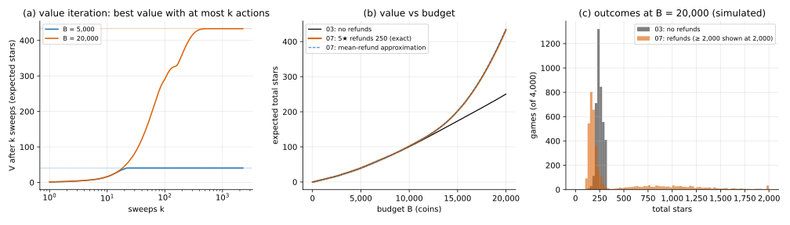

# Value iteration

## Idea

Backward induction needs an order: compute each $V(b, L)$ from entries already done. In
03 that order was "small $b$ first", because every action lowered $b$. With refunds a hit
can raise $b$, and the state can come back to itself, so no such order exists.

Instead, treat the Bellman equation as a fixed point and iterate:

```math
V_{k+1}(b, L) = \max\Big\{ r_L + \sum_j P(L,j)\, V_k(b - h + g_j,\, L),\;\; U_L\, V_k(b - C_L,\, L+1) + (1 - U_L)\, V_k(b - C_L,\, L),\;\; 0 \Big\}
```

Start from $V_0 = 0$. Then $V_k$ is the best expected value of the game **cut off after
$k$ actions**, so it only rises, and it reaches $V$ once $k$ is longer than any game that
matters. Stop when a full sweep changes nothing (here: by less than $10^{-9}$).

Two ways to sweep:

- **Jacobi**: compute all of $V_{k+1}$ from $V_k$ at once (vectorised).
- **Gauss–Seidel**: go through $b$ in some order and overwrite in place, so later entries
  in the same sweep already use the new values.

The table is cut at $b$ = 40,000: a refund that would go past it is capped there.

## When it applies

- The state can repeat: coins can go up (refunds, income) or there's no end in sight
  (infinite horizon, usually with discounting).
- The value must be finite. Here every level's net hit cost $h - E[g]$ is positive, so
  coins drift down and every game ends. If some level's mean refund beat the hit cost,
  you could hit forever and the expected stars would be unbounded.
- If the state never repeats, backward induction is faster: one pass instead of
  many.

## On the running example

Refunds $g$ = (0, 0, 0, 0, 250): only a 5★ item refunds, 250 coins. Grid step 50 coins.

**Checks**

- **No refunds**: value iteration needs 101 sweeps at 20,000 and matches 03's backward
  induction to about $10^{-13}$.
- **Cap**: $V$(5,000) and $V$(20,000) are the same to 4 decimals with the table cut at
  30,000, 40,000 or 60,000.
- **Simulator** (4,000 games): 40.67 ± 0.22 vs 40.64 at 5,000; 436.13 ± 14.26 vs 433.16 at
  20,000.

**Convergence**

| sweep | sweeps to converge (whole table to 40,000) |
|---|---|
| Jacobi | 2,269 |
| Gauss–Seidel, $b$ increasing | 1,668 |
| Gauss–Seidel, $b$ decreasing | 627 |

All three agree to $10^{-7}$. Small budgets settle fast: $V$(5,000) is within 0.01 of its
limit after 22 Jacobi sweeps, $V$(10,000) after 47, $V$(20,000) after 611. Long games
take many sweeps: at level 7 a hit costs 32.5 coins on average, so 20,000 coins last
hundreds of hits.

Sweep order matters here: going down in $b$ took 2.7 times fewer sweeps than going up.
A likely reason: at level 7 a hit raises $b$ with probability 0.67 (a 5★ item), so most
lookups there are at a larger $b$, which a decreasing sweep has already updated.

**Mean-refund approximation**: replace refunds by their average, so a hit at level $L$
costs $h - E[g]$ and coins only go down. 03's backward induction (on a 0.5-coin grid)
gives 101.58 at 10,000 (exact 102.01) and 436.77 at 20,000 (exact 433.16).



- (a) $V_k$ rising to $V$; at 20,000 it takes hundreds of sweeps.
- (b) The curves split above about 10,000.
- (c) The outcome at 20,000 splits: 58% of games end below 213 stars (03's 10th
  percentile), 29% above 400.

## Code

[`solve.py`](solve.py)

- `value_iteration(game, b_cap, tol, policy=None) -> (V, A, sweeps, history)`: Jacobi;
  with `policy` it evaluates that policy instead.
- `gauss_seidel(game, b_cap, tol, ascending=True) -> (V, A, sweeps)`.
- `mean_refund_value(game, B_max)`: the approximation, by backward induction.
- `thresholds(A, unit, b_max)`: per level, the budget from which the policy always upgrades.
- `main()`: all numbers on this page and `value_iteration.svg`.

Refunds live in `common/model.py` (`Game.refund`, `with_refund`, `Game.mean_refund`), and
the simulator pays them.

```
python solve.py
```
