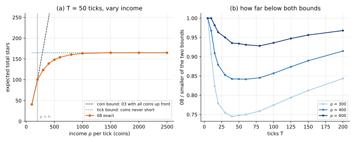

# 08 · `Ir-Ur-Bt-Ec-Oe-Kk`: coins trickle in

| Axis | Value | Meaning here |
|---|---|---|
| I | `Ir` | a hit at level $L$ gives a $j$★ item with probability $P(L, j)$ |
| U | `Ur` | an upgrade from $L$ succeeds with probability $U_L$; you pay $C_L$ either way |
| B | **`Bt`** | $\rho$ coins arrive at the start of each tick, for $T$ ticks |
| E | `Ec` | closed economy: items don't produce coins |
| O | `Oe` | maximise expected total stars |
| K | `Kk` | all numbers known |

**What changed from [03](../03_Ir-Ur-Bk-Ec-Oe-Kk/):** the coins don't come all at once.
The game now has a clock. Each tick, $\rho$ coins arrive, then you take **one** action:
hit, upgrade, or wait. After $T$ ticks the game ends; leftover coins are worth nothing.
(Starting coins $B_0 = 0$ on this page.)

## Formulation

State $(t, b, L)$, with $b$ the coins held before this tick's income:

```math
V(t, b, L) = \max\Big\{ V(t+1,\, b+\rho,\, L),\;\; r_L + V(t+1,\, b+\rho-h,\, L),\;\; U_L\, V(t+1,\, b+\rho-C_L,\, L+1) + (1-U_L)\, V(t+1,\, b+\rho-C_L,\, L) \Big\}
```

with $V(T, b, L) = 0$. The first term is "wait".

## Why the previous tools fall short

- **03's order** ("small $b$ first") breaks: income raises $b$.
- **07's value iteration** would work, but isn't needed: time only goes forward. Fill
  the table from $t = T$ down to 0, once. Adding time to the state restores an order.

## Tools

| Method | What it gives | Link |
|---|---|---|
| **Time-indexed DP** | exact policy over $(t, b, L)$ by backward induction in time | [time_indexed_dp/](time_indexed_dp/) |
| **Two bounds** | coins up front (03 with $\rho T$ coins) and coins never short (only ticks limit you) | [time_indexed_dp/](time_indexed_dp/) |

## Two budgets

You now have two budgets: **coins** ($\rho T$ in total) and **ticks** ($T$ actions at
most). Each gives an upper bound:

- **coin bound**: 03 with all $\rho T$ coins up front;
- **tick bound**: the same $T$ ticks with coins never short.

**If income per tick is at most the cheapest action ($\rho \le h$), the coin bound is
exact:** 08 is 03 with $\rho T$ coins, whatever $T$ is. Waiting costs nothing, and every
action costs at least one tick's income, so the ticks never run out first (proof in
[time_indexed_dp](time_indexed_dp/)). The clock only matters when coins come faster
than you can spend them.

## On the running example



$T$ = 50 ticks:

| $\rho$ | 08 exact | coin bound | tick bound |
|---|---|---|---|
| 100 | 40.64 | 40.64 | 164.97 |
| 200 (= $h$) | 100.25 | 100.25 | 164.97 |
| 300 | 123.38 | 173.47 | 164.97 |
| 400 | 138.90 | 250.35 | 164.97 |
| 1,000 | 163.44 | 796.36 | 164.97 |
| 2,500 | 164.97 | 2,381.20 | 164.97 |

- **$\rho \le 200$: exactly 03** (checked to 4 decimals for $T$ from 10 to 200).
- **Large $\rho$: the tick bound takes over.** At 2,500 per tick (the dearest upgrade) you
  can always afford what you want, and only ticks count.
- **In between, both bind.** With $\rho$ = 400 and $T$ = 50 you get the same 20,000 coins
  as 03 at 20,000, but 138.90 stars instead of 250.35, and 16% below the tick bound
  too. (b) of the figure: the gap to the smaller bound is largest for $\rho$ just
  above $h$ and middle $T$ (about 25% at $\rho$ = 300, $T$ = 40).
- **With coins never short, the policy is a threshold rule in time:** upgrade from
  level $L$ while ticks left ≥ 6 · 7 · 9 · 13 · 23 · 42. Same shape as 03's thresholds in
  coins; now the scarce resource is ticks.

**Takeaways**

- **Time in the state restores an order.** Coins can go up, but $t$ only goes forward,
  so one backward pass in $t$ is exact.
- **Look for the binding budget first.** Here a one-line condition ($\rho \le h$) says the
  clock doesn't matter at all.

## What's next

[09](../09_Ir-Ur-Bk-Ei-Oe-Kk/): the income comes from the items themselves: each item
held pays coins every tick ($E$: `Ec → Ei`).
