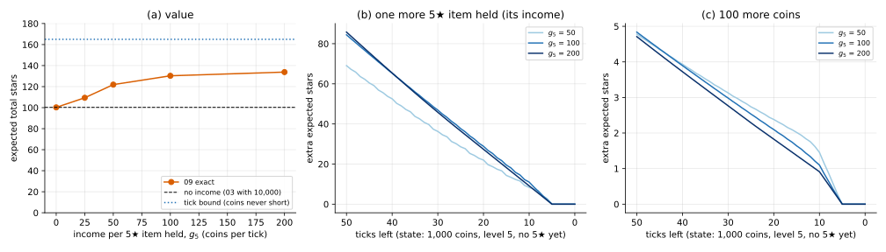

# 09 · `Ir-Ur-Bk-Ei-Oe-Kk`: items pay income

| Axis | Value | Meaning here |
|---|---|---|
| I | `Ir` | a hit at level $L$ gives a $j$★ item with probability $P(L, j)$ |
| U | `Ur` | an upgrade from $L$ succeeds with probability $U_L$; you pay $C_L$ either way |
| B | `Bk` | starting coins $B_0$ known; no outside income |
| E | **`Ei`** | every item you hold pays $g_j$ coins per tick |
| O | `Oe` | maximise expected total stars |
| K | `Kk` | all numbers known |

**What changed from [08](../08_Ir-Ur-Bt-Ec-Oe-Kk/):** the income comes from your items,
not from outside. 08's clock stays: $T$ ticks, one action per tick (hit, upgrade, wait).
An item now does two jobs: its stars count at the end, and it pays coins until then.
Items are **capital**.

On the running example: $B_0$ = 10,000, $T$ = 50, and **only 5★ items pay**, $g_5$ coins
per tick each. Then the income is $g_5 n$, with $n$ the number of 5★ items held, and one
counter is enough to track it.

## Formulation

State $(t, b, n, L)$. Income arrives first, $b' = b + g_5 n$; then

```math
V(t, b, n, L) = \max\Big\{ V(t+1, b', n, L),\;\; r_L + P(L,5)\, V(t+1, b'-h, n+1, L) + \big(1-P(L,5)\big)\, V(t+1, b'-h, n, L),\;\; U_L\, V(t+1, b'-C_L, n, L+1) + (1-U_L)\, V(t+1, b'-C_L, n, L) \Big\}
```

with $V(T, \cdot) = 0$. A hit now changes the state in two ways: stars (paid out as
$r_L$) and, with probability $P(L,5)$, one more earner.

## Why the previous tools fall short

- 08's state $(t, b, L)$ can't tell 0 earners from 5: same coins, very different futures.
- With general $g_j$ the state would need the whole income $\sum_k g_{j_k}$; paying only
  5★ items keeps it to one counter.

## Tools

| Method | What it gives | Link |
|---|---|---|
| **Time-indexed DP** (08's, on a bigger state) | exact policy over $(t, b, n, L)$ | [time_indexed_dp/](time_indexed_dp/) |
| **Shadow prices** | what one more coin or one more earning item is worth, read off $V$ | [time_indexed_dp/](time_indexed_dp/) |

## On the running example

| $g_5$ (coins per tick per 5★ item) | value | reach level 5 | final level | 5★ items held |
|---|---|---|---|---|
| 0 (= 03 with 10,000) | 100.25 | 0 | 3.60 | 0.45 |
| 25 | 109.38 | 0.54 | 4.44 | 3.05 |
| 50 | 121.90 | 0.76 | 4.83 | 4.94 |
| 100 | 130.29 | 0.81 | 5.07 | 6.55 |
| 200 | 133.81 | 0.82 | 5.25 | 7.88 |

(Value exact; the other columns simulated, 4,000 games.) Upper bound: 164.97, 08's tick
bound (50 actions, coins never short).

- **Income makes climbing pay.** Without it, 10,000 coins never take the policy to
  level 5. With it, the policy goes for level 5 first (median: reached on tick 6),
  because there 13% of hits make an earner.
- **Diminishing returns:** from $g_5$ = 100 to 200 the value rises only 3.5. Once the
  income covers a hit every tick, the clock binds and extra coins have nothing to buy.
- **Shadow prices fall to zero before the end.** At 1,000 coins and level 5, an extra
  earner is worth 84 future stars with 50 ticks left ($g_5$ = 100), falling about
  linearly, and **exactly 0 with 5 or fewer ticks left**: 1,000 coins already pay for a
  hit on every remaining tick. Extra coins follow the same pattern. No upgrade is tried
  with fewer than 6 ticks left.



**Takeaways**

- **Items as capital** add a state variable: what you own decides what you earn.
- **A coin's value depends on time and on which budget binds.** Early, coins buy actions
  that buy earners; late, ticks bind and coins are worth nothing.

## What's next

[10](../10_Ir-Ur-Bk-Es-Oe-Kk/): items can be sold for coins, but then they no longer count
($E$: `Ec → Es`).
