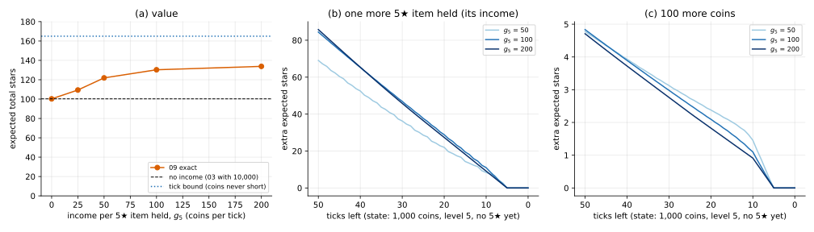

# Time-indexed DP with items as capital

## Idea

08's method, one more state variable. When items pay income, the state must say how much
you earn per tick. With only 5★ items paying, that's the count $n$ of 5★ items held:

```math
V(t, b, n, L) = \max\Big\{ V(t+1, b', n, L),\;\; r_L + P(L,5)\, V(t+1, b'-h, n+1, L) + \big(1-P(L,5)\big)\, V(t+1, b'-h, n, L),\;\; U_L\, V(t+1, b'-C_L, n, L+1) + (1-U_L)\, V(t+1, b'-C_L, n, L) \Big\}
```

with $b' = b + g_5 n$. Still one backward pass in $t$.

**Table size.** $n \le t$, so coins stay below $B_0 + g_5 T^2$. At $g_5$ = 200 that's
5,101 coin values × 51 counts × 7 levels per tick, a few seconds per $g_5$.

## Shadow prices

The table answers "what is one more X worth?" directly, by differencing $V$:

- one more coin: $V(t, b + \Delta, n, L) - V(t, b, n, L)$, per $\Delta$ coins;
- one more earner: $V(t, b, n+1, L) - V(t, b, n, L)$.

These are **shadow prices**: the stars you'd give up for one more unit. They change with
time: a coin early can buy an earner that pays for many ticks; a coin late may buy
nothing. In continuous-time optimal control the same quantities are the costates of
Pontryagin's maximum principle; here we just read them off the table.

## When it applies

- What you own pays you over time, and the income can be tracked by a few counters.
- With income from every tier (different $g_j$), the state needs the total income, which
  can take many values; the table grows accordingly.

## On the running example

$B_0$ = 10,000, $T$ = 50, one action per tick, only 5★ items pay $g_5$ per tick.

**Checks:** $g_5$ = 0 gives 100.25 (03 with 10,000; 50 ticks don't bind). Simulator,
4,000 games: 109.53 ± 1.31 vs 109.38 ($g_5$ = 25), 122.25 ± 1.62 vs 121.90 (50),
131.72 ± 1.67 vs 130.29 (100), 135.10 ± 1.67 vs 133.81 (200).

**Shadow prices** at 1,000 coins, level 5, no earners yet:

| ticks left | 50 | 30 | 10 | 5 |
|---|---|---|---|---|
| one more earner, $g_5$ = 50 | 69.1 | 36.3 | 8.4 | 0 |
| one more earner, $g_5$ = 100 | 84.4 | 46.9 | 11.0 | 0 |
| one more earner, $g_5$ = 200 | 85.8 | 45.8 | 9.1 | 0 |
| 100 more coins, $g_5$ = 100 | 4.84 | 2.98 | 1.10 | 0 |

- With 5 ticks left, 1,000 coins already pay for a hit every tick, so neither coins nor
  income can buy anything more: both prices are exactly 0.
- An earner paying 100 per tick is worth about as much as one paying 200 (84.4 vs 85.8
  with 50 ticks left).
- No upgrade is tried with fewer than 6 ticks left, at any $g_5$ tried.



## Code

[`solve.py`](solve.py)

- `solve(game, g5, T, B0, keep_V=False)`: value and action table over $(t, b, n, L)$;
  `keep_V` keeps a slice of $V$ for shadow prices.
- `income_policy`, `play`: a small simulator with item income (tracks $n$, the final
  level and when level 5 is first reached).
- `main()`: all numbers on this page and `income.svg`. Uses 08's solver for the
  no-income and tick-bound checks.

```
python solve.py
```
