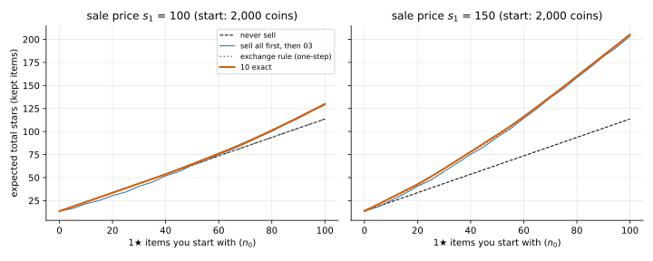

# 10 · `Ir-Ur-Bk-Es-Oe-Kk`: items can be sold

| Axis | Value | Meaning here |
|---|---|---|
| I | `Ir` | a hit at level $L$ gives a $j$★ item with probability $P(L, j)$ |
| U | `Ur` | an upgrade from $L$ succeeds with probability $U_L$; you pay $C_L$ either way |
| B | `Bk` | budget $B$ known up front |
| E | **`Es`** | you can sell items for coins; a sold item no longer counts |
| O | `Oe` | maximise expected total stars (of the items you keep) |
| K | `Kk` | all numbers known |

**What changed from [03](../03_Ir-Ur-Bk-Ec-Oe-Kk/):** items can be turned back into coins.
On the running example only 1★ items have a buyer, at $s_1$ coins each, less than a hit
costs ($s_1 \lt h$). You can sell at any time, so unsold 1★ items are a **reserve of
coins**.

## Formulation

State $(b, n, L)$, with $n$ the unsold 1★ items held:

```math
V(b, n, L) = \max\Big\{ -1 + V(b + s_1, n - 1, L),\;\; r_L + p_1\, V(b - h, n + 1, L) + (1 - p_1)\, V(b - h, n, L),\;\; U_L\, V(b - C_L, n, L+1) + (1 - U_L)\, V(b - C_L, n, L),\;\; 0 \Big\}
```

with $p_1 = P(L, 1)$; the first term (sell one) needs $n \ge 1$.

## Why the previous tools fall short

- 03's state can't tell 0 items in reserve from 50.
- Coins can go up (selling), so 03's order "small $b$ first" breaks. But no iteration
  is needed (unlike 07): **liquid wealth** $b + s_1 n$ never goes up. Selling keeps it the
  same and lowers $n$; a hit or upgrade lowers it. Fill the table in that order.

## Tools

| Method | What it gives | Link |
|---|---|---|
| **Inventory DP** | exact policy over $(b, n, L)$, filled in order of liquid wealth | [inventory_dp/](inventory_dp/) |
| **Exchange rule** (heuristic) | sell iff one sale buys more stars than it costs: $s_1 r_L / h \gt 1$ | [inventory_dp/](inventory_dp/) |

## On the running example

Starting with coins only:

| $s_1$ | budget | never sell (03) | 10 exact | exchange rule |
|---|---|---|---|---|
| 50 | 5,000 | 40.64 | 40.64 | 40.64 |
| 100 | 5,000 | 40.64 | 40.90 | 40.50 |
| 150 | 5,000 | 40.64 | 42.73 | 41.94 |
| 150 | 20,000 | 250.35 | 251.34 | 250.89 |

- **Selling barely helps: at most +2.5 stars at the budgets tried (5% at 5,000).** A sale undoes a past hit at a loss
  ($s_1 \lt h$). It only pays if coins are worth more now than when the item was made
  (you've climbed since, or need coins for one more upgrade), and good play makes few
  1★ items. On `LONG_SHOT` (03's stress example) selling gains nothing at all.
- **The exchange rule can be worse than never selling** (40.50 vs 40.64 at $s_1$ = 100).

**Stress example, built for this: start with an inventory.** 2,000 coins plus $n_0$ 1★
items:

| $s_1$ | $n_0$ | never sell | sell all first, then 03 | 10 exact | exchange rule |
|---|---|---|---|---|---|
| 100 | 50 | 63.60 | 63.54 | 64.71 | 63.60 |
| 100 | 100 | 113.60 | 128.84 | 130.00 | 113.60 |
| 150 | 50 | 63.60 | 93.89 | 96.40 | 95.11 |
| 150 | 100 | 113.60 | 203.48 | 205.31 | 204.70 |

- **Now selling is worth a lot**: +52% at $s_1$ = 150, $n_0$ = 50. The items fund the climb.
- **The exact policy sells as it goes**, not all at once: at $s_1$ = 100, $n_0$ = 100 it
  sells 6 at the start and about 101 over the game (including new 1★ items). Keeping a
  reserve beats selling everything first by 1.2 to 2.5 stars.
- **The one-step exchange rule misses why to sell.** At $s_1$ = 100 a sale at level 1 or 2
  buys fewer stars (0.68, 0.89) than it costs, so the rule never sells there, never funds
  the climb, and matches "never sell" (113.60 vs 130.00).



**Takeaways**

- **Inventory is state.** What you hold decides what you can do later.
- **Look for an order before iterating.** Coins go up, but a combined quantity (liquid
  wealth) never does.
- **A sale is worth what the coins buy next**, including upgrades, not just the next hit.

## What's next

[11](../11_Ir-Ur-Bk-Ec-Oe-Kb/): back to 03, but the odds $P$ and $U$ are unknown; you learn
them as you play ($K$: `Kk → Kb`).
