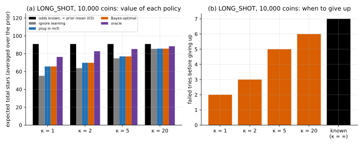

# 11 · `Ir-Ur-Bk-Ec-Oe-Kb`: odds unknown, family known

| Axis | Value | Meaning here |
|---|---|---|
| I | `Ir` | a hit at level $L$ gives a $j$★ item with probability $P(L, j)$ (known) |
| U | `Ur` | an upgrade from $L$ succeeds with probability $U_L$; you pay $C_L$ either way |
| B | `Bk` | budget $B$ known up front |
| E | `Ec` | closed economy: items don't produce coins |
| O | `Oe` | maximise expected total stars |
| K | **`Kb`** | the upgrade odds $U_L$ are unknown; each has a known prior, Beta($a_L$, $b_L$) |

**What changed from [03](../03_Ir-Ur-Bk-Ec-Oe-Kk/):** you don't know how likely an upgrade
is to work. You learn from your own tries. On this page the item odds $P$ stay known;
only $U$ is uncertain.

The prior for $U_L$ has mean equal to the running example's $U_L$ and **concentration**
$\kappa = a_L + b_L$: $\kappa$ = 2 is very unsure, $\kappa$ = 20 fairly sure, $\kappa \to \infty$ is 03.

## Formulation

Each try is a coin flip with unknown bias, so the Beta prior updates by counting. You
never return to a level, so only the current level's belief matters, and while on level
$L$ you've seen $f$ failures and no success. The chance the next try works is the
posterior mean

```math
m_L(f) = \frac{a_L}{a_L + b_L + f}
```

So the state is $(b, L, f)$:

```math
V(b, L, f) = \max\Big\{ r_L + V(b-h, L, f),\;\; m_L(f)\, V(b - C_L, L+1, 0) + \big(1 - m_L(f)\big)\, V(b - C_L, L, f+1),\;\; 0 \Big\}
```

$V(B, 0, 0)$ is the value averaged over the prior: over all the games $U$ might be.

## Why the previous tools fall short

- 03 needs $U$. Plugging in the prior mean and never updating ignores what failures tell
  you: after 5 failures in a row, a 10% upgrade looks worse than 10%.
- Each failure changes what you believe, so the belief has to be in the state.

## Tools

| Method | What it gives | Link |
|---|---|---|
| **Bayes-adaptive MDP** | exact optimum over (coins, level, failures so far); the SLAM parallel | [bayesian_adaptive_mdp/](bayesian_adaptive_mdp/) |
| **Thompson sampling** | draw the odds from the posterior, act as if true; needs only 03's solver | [thompson_sampling/](thompson_sampling/) |

## On the running example

Values averaged over the prior, 20,000 coins (oracle and Thompson simulated, 95%
intervals):

| $\kappa$ | ignore learning | plug in $m_L(f)$ | Bayes-optimal | Thompson | oracle (told $U$) |
|---|---|---|---|---|---|
| 2 | 219.79 | 227.89 | 227.91 | 213.32 ± 2.60 | 239.19 ± 3.03 |
| 5 | 239.53 | 240.76 | 240.78 | 232.89 ± 2.22 | 245.58 ± 1.90 |
| 20 | 248.06 | 248.08 | 248.08 | 247.37 ± 1.85 | 250.21 ± 0.94 |

For reference, 03 with $U$ exactly equal to the prior mean: 250.35.

**Stress example: `LONG_SHOT`** (one upgrade, prior mean 10%), 10,000 coins:

| $\kappa$ | ignore learning | plug in $m(f)$ | Bayes-optimal | Thompson | oracle |
|---|---|---|---|---|---|
| 1 | 55.23 | 65.70 | 65.70 | 60.73 ± 1.97 | 76.41 ± 2.25 |
| 2 | 63.82 | 69.78 | 69.78 | 64.55 ± 2.17 | 82.74 ± 2.28 |
| 5 | 74.80 | 76.94 | 76.94 | 72.80 ± 2.36 | 85.27 ± 1.96 |
| 20 | 85.43 | 85.65 | 85.65 | 85.19 ± 2.50 | 88.39 ± 1.42 |

Known odds (03): 90.88.



- **Learning from failures pays**: up to 19% on `LONG_SHOT` ($\kappa$ = 1: 65.70 vs 55.23),
  3.7% on the running example ($\kappa$ = 2). The Bayes policy gives up sooner the less
  sure the prior: with every try failing, 2 tries at $\kappa$ = 1, 7 with known odds.
- **Updating is enough; planning for future learning adds almost nothing here.** Playing
  03 with the current posterior mean is within 0.02 stars of Bayes-optimal in every case
  (identical on `LONG_SHOT` for $\kappa$ = 1, 2).
- **Thompson sampling loses 3–8% when the prior is vague** ($\kappa \le 5$), and on the running example at
  $\kappa$ = 2 it's below not learning at all. It switches back from hitting to upgrading
  about 2.5 times per game: one draw says "give up", the next says "try again", and coins
  are lost in between.
- **Unknown odds cost even an oracle.** Averaged over the prior, knowing $U$ gives 239.19,
  below 250.35 for $U$ fixed at its mean: bad draws of $U$ hurt more than good draws help
  (Jensen, the other way from 05). The gap between oracle and Bayes-optimal (11 stars at
  $\kappa$ = 2) is what knowing the odds would be worth.

**Takeaways**

- **Unknown parameters → belief in the state.** With a conjugate prior (Beta for a
  success rate) the belief is a few counters.
- **Here, update and act as if the posterior mean were true.** The exact method says how
  much that leaves on the table: almost nothing on these examples.
- **Thompson sampling is a bandit tool.** In a stopping problem, re-drawing every step
  makes it change its mind.

## What's next

[12](../12_Ir-Ur-Bk-Ec-Oe-Ku/): no prior at all, no model; learn values from play
($K$: `Kb → Ku`).
