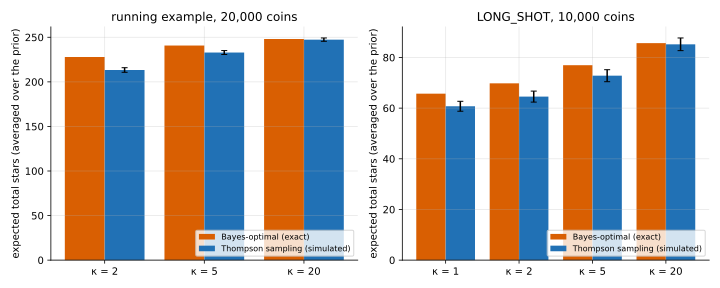

# Thompson sampling

## Idea

Before each decision, **draw** the unknown parameters from the posterior and act
optimally as if the draw were the truth. Uncertain options get tried sometimes, in
proportion to the chance they're the best, and as evidence comes in the draws narrow
and the behaviour settles.

Here: draw $U_L \sim$ Beta($a_L$, $b_L + f$) for the level you're on (other levels at their
prior mean) and play 03's action for that draw. It needs only the known-odds solver, no
Bayes-adaptive DP.

## When it applies

- **Bandits**: many options, each pull is cheap, the only way to learn about an option is
  to try it, and a bad draw costs one pull.
- Large problems where the Bayes-adaptive DP is out of reach and a solver for known
  parameters exists.

It fits this game less well. Giving up (hitting) spends coins, and a later draw can send
you back to upgrading with fewer coins. It doesn't commit.

## On the running example

Simulated (true $U$ drawn from the prior; 2,000 games for the running example, 4,000 for
`LONG_SHOT`), against the exact Bayes optimum:

| example | $\kappa$ | Bayes-optimal | Thompson | switches from hitting back to upgrading |
|---|---|---|---|---|
| running, 20,000 coins | 2 | 227.91 | 213.32 ± 2.60 | 2.46 per game |
| | 5 | 240.78 | 232.89 ± 2.22 | 1.53 |
| | 20 | 248.08 | 247.37 ± 1.85 | 0.87 |
| `LONG_SHOT`, 10,000 coins | 1 | 65.70 | 60.73 ± 1.97 | 2.62 |
| | 2 | 69.78 | 64.55 ± 2.17 | 2.75 |
| | 5 | 76.94 | 72.80 ± 2.36 | 2.47 |
| | 20 | 85.65 | 85.19 ± 2.50 | 1.33 |

- With a vague prior ($\kappa \le 5$) Thompson loses 3–8%. On the running example at $\kappa$ = 2 it's worse
  than ignoring learning (219.79).
- With a confident prior ($\kappa$ = 20) it's within the noise of the optimum.



## Code

[`solve.py`](solve.py)

- `thompson_play(game, kappa, U_true, B, rng, tables)`: one game; draws rounded to 0.01 so
  03's tables can be cached.
- `main()`: the table above and `thompson.svg`.

```
python solve.py
```
