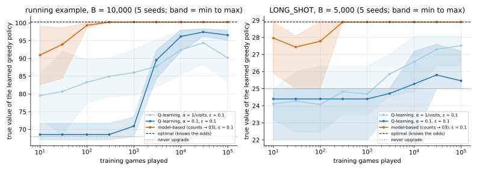

# 12 · `Ir-Ur-Bk-Ec-Oe-Ku`: nothing known

| Axis | Value | Meaning here |
|---|---|---|
| I | `Ir` | a hit at level $L$ gives a $j$★ item with probability $P(L, j)$ (unknown) |
| U | `Ur` | an upgrade from $L$ succeeds with probability $U_L$ (unknown); you pay $C_L$ either way |
| B | `Bk` | budget $B$ known up front |
| E | `Ec` | closed economy: items don't produce coins |
| O | `Oe` | maximise expected total stars |
| K | **`Ku`** | no odds, no prior: you only know the rules and what you've seen |

**What changed from [11](../11_Ir-Ur-Bk-Ec-Oe-Kb/):** no prior. You play the same game
(same budget) many times and learn from experience. The question becomes: **how many
games until you play well?**

## Formulation

The target is still 03's optimum. Write it per action: $Q(b, L, a)$ = expected stars from
here if you take action $a$ now and play optimally after.

```math
Q(b, L, \text{hit}) = r_L + \max_{a'} Q(b-h, L, a'), \qquad Q(b, L, \text{up}) = U_L \max_{a'} Q(b - C_L, L+1, a') + (1 - U_L) \max_{a'} Q(b - C_L, L, a')
```

You can't compute the right-hand sides ($r_L$ and $U_L$ are unknown), but every move you
make gives a **sample** of one.

## Why the previous tools fall short

- 03–11 all need the odds, or a prior over them.
- Without a prior there's no belief to put in the state; you learn from data instead.

## Tools

| Method | What it gives | Link |
|---|---|---|
| **Q-learning** (model-free) | nudges $Q$ towards each sampled right-hand side; never estimates $P$ or $U$ | [model_free_rl/](model_free_rl/) |
| **Model-based learning** | counts outcomes, estimates $P$ and $U$, re-solves 03 every 100 games | [model_free_rl/](model_free_rl/) |

Both explore with $\varepsilon$-greedy ($\varepsilon$ = 0.1: a random action 10% of the time).
Score: the **true** value of the greedy policy learned so far, computed exactly with the
real odds.

## On the running example

Budget 10,000 (optimal 100.25; never upgrading gives 68.00). Mean over 5 seeds:

| games played | 100 | 1,000 | 10,000 | 100,000 |
|---|---|---|---|---|
| Q-learning, $\alpha$ = 0.1 | 68.56 | 70.95 | 96.19 | 96.56 |
| Q-learning, $\alpha$ = 1/visits | 83.29 | 86.03 | 92.42 | 90.18 |
| model-based | 99.34 | 100.25 | 100.25 | 100.25 |

**Stress example, `LONG_SHOT`** at 5,000 (optimal 28.90; never upgrading 25.00):

| games played | 100 | 1,000 | 10,000 | 100,000 |
|---|---|---|---|---|
| Q-learning, $\alpha$ = 0.1 | 24.40 | 24.40 | 25.28 | 25.46 |
| Q-learning, $\alpha$ = 1/visits | 24.07 | 24.69 | 26.57 | 27.52 |
| model-based | 27.78 | 28.90 | 28.90 | 28.90 |



- **The model-based learner is optimal (to 0.1 stars) after 300 games** on both examples,
  every seed.
- **Q-learning is still 3–10% short after 100,000 games** on the running example, and on
  `LONG_SHOT` it has learned only part of the gain from upgrading. Its curves aren't
  monotone either: with $\alpha$ = 1/visits it was better at 30,000 games (94.38) than at
  100,000.
- **Why the gap:** the model-based learner pools its data. Every hit at level $L$ teaches it
  about $P(L, \cdot)$ at every budget, and every try teaches it about $U_L$. Q-learning
  learns each (coins, level, action) entry on its own, and states like "level 6 with
  plenty of coins" come up rarely.

**Takeaways**

- **If you can write the model down, learn the model.** Here it's a handful of
  probabilities, and 03's solver does the rest.
- **Model-free methods earn their place when the model is hard to write or too big to
  solve**, not on a game this small.

## What's next

[13](../13_Ir-Ur-Bh-Ei-Oe-Kb/): everything at once: hidden budget, items paying income,
unknown odds.
